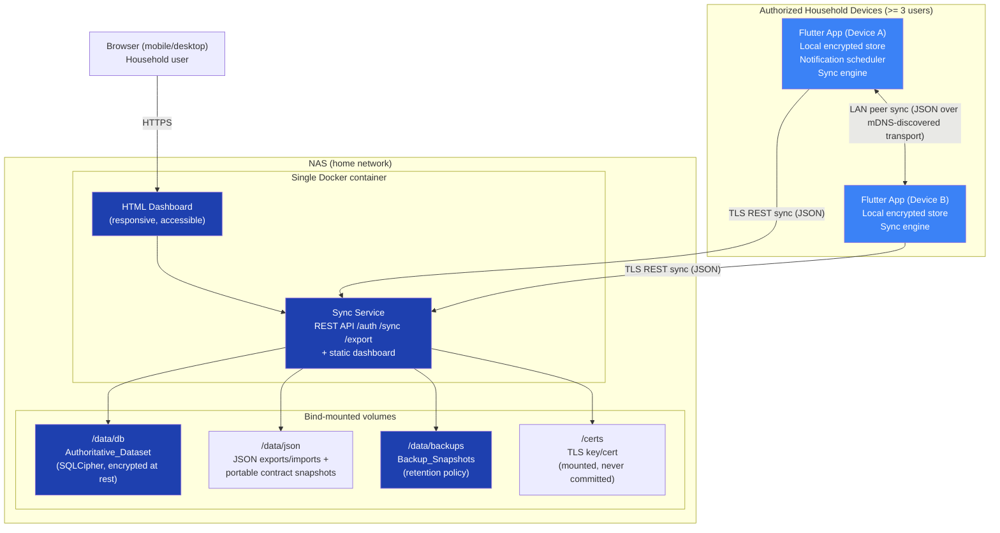
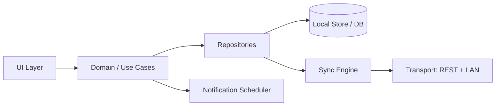
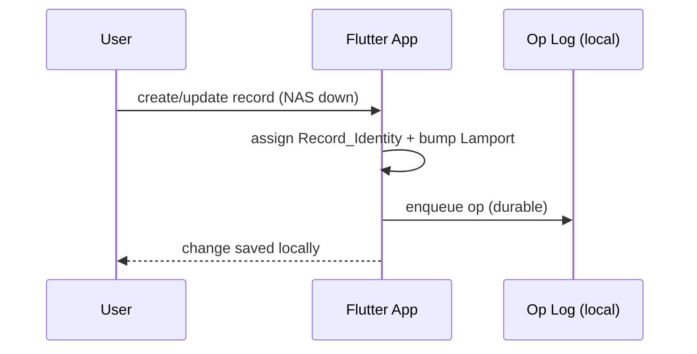
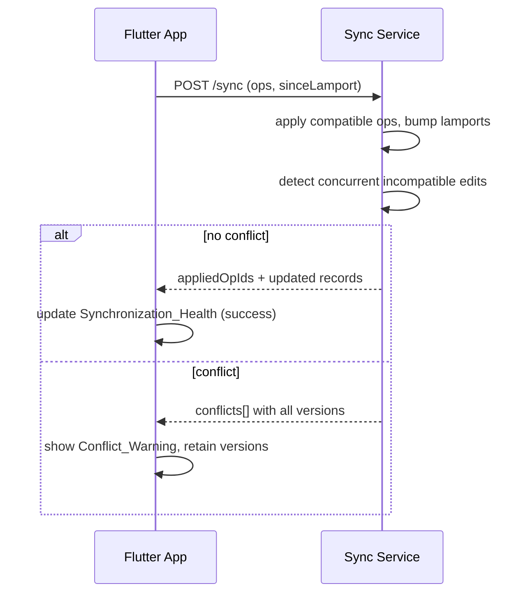
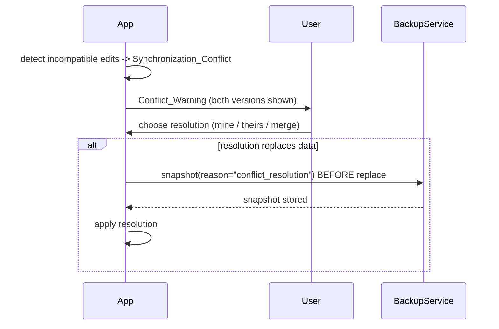

# Design Document

## Overview

Credit Card Expense Reminders is a two-part system that replaces a household Excel tracker with an offline-first workflow for at least three authorized users:

1. A **native Flutter Android app** that owns local data, works fully offline, schedules local notifications, and reconciles changes with a NAS and with peer devices on the home LAN.
2. A **NAS-hosted backend + responsive HTML dashboard** that hosts the `Authoritative_Dataset`, exposes a sync REST API, and serves an accessible dashboard for centralized tracking.

The two clients (Flutter app, HTML dashboard) never treat a JSON file as a concurrent mutable store. Shared state is a set of versioned records with durable identity and revision metadata, exchanged as JSON over a REST sync API (NAS) and over a LAN transport (peer-to-peer). JSON is used strictly as interoperable transport and export/import format.

Card-Nudge (MIT) and deq (the `Reference_Project`s) inform comparable functionality and interface direction. Because Card-Nudge is MIT-licensed, this design additionally permits pragmatic reuse of selected Card-Nudge material (UI screens, card/reminder domain models, and `flutter_local_notifications` wiring) with its license and attribution retained, while the data layer, sync engine, totals, and NAS dashboard remain original (see "Code Reuse Strategy"). Third-party material is included only under a permitting license (Requirement 13).

### Requirement coverage map

| Area | Requirements |
|------|--------------|
| Offline native tracker | 1 |
| Card profiles + validation | 2 |
| Card bills + monthly totals | 3 |
| Recurring obligations | 4 |
| Vendor follow-ups + claims | 5 |
| Accessible status | 6 |
| Local notifications | 7 |
| Month-wise comparison | 8 |
| NAS dashboard + shared access | 9 |
| Sync / reconciliation / recovery | 10 |
| Export / import | 11 |
| Privacy / auth / encryption | 12 |
| Originality / licensing | 13 |

### Technology decisions at a glance

| Concern | Decision | Status |
|---------|----------|--------|
| App framework | Flutter (Android target) | Fixed by Req 1.1 |
| Local storage | **Drift (SQLite)** with SQLCipher encryption | **Resolved** (user accepted Drift/SQLCipher over Hive) |
| Local notifications | `flutter_local_notifications` + `android_alarm_manager_plus` for reboot rescheduling | Recommended |
| NAS backend | **Single Docker container** (Go or Node/TypeScript) serving REST sync API + static dashboard, with bind-mounted data/backup/cert volumes | **Resolved** (single container + bind-mounted volumes; host NAS product remains a host-specific note) |
| Dashboard | Server-rendered + progressive-enhancement HTML/CSS/vanilla-or-lightweight JS; accessible by default | Recommended |
| Sync model | Operation-log + per-record UUID identity + Lamport-counter revision + per-record-type merge policy | Recommended |
| Wire format | JSON for REST and LAN sync | Recommended (Protobuf not justified) |
| Peer discovery | mDNS/DNS-SD on the LAN | Recommended default; exact transport is an Open Decision |
| Auth | Per-user accounts + bearer tokens over TLS (self-signed/local CA on home network) | Pragmatic default; final provider is an Open Decision |
| Encryption | SQLCipher at rest (app), encrypted volume/field encryption at rest (NAS), TLS in transit | Recommended |

## Architecture



### Sync paths

- **Primary path (NAS reachable):** each Flutter app pushes/pulls its operation log to the NAS sync service over TLS; the NAS holds the `Authoritative_Dataset` and reconciles.
- **Fallback path (NAS unavailable):** apps discover each other via mDNS on the LAN and exchange operation logs peer-to-peer so household devices converge even without the NAS (Requirement 10.4).
- **Dashboard path:** the browser talks only to the NAS service; it is a thin client of the `Authoritative_Dataset` and submits edits as shared changes for reconciliation (Requirement 9.7).

### Layering (both clients)



The domain layer is pure (no I/O) so that totals, recurrence generation, validation, and merge logic are directly testable with property-based tests. Repositories and transports are the only I/O boundaries.

## Local Storage Decision (Flutter)

Requirement Open Decision #9 asks whether Hive is suitable. Evaluation:

| Criterion | Hive | Isar | **Drift (SQLite)** |
|-----------|------|------|--------------------|
| Query needs (month aggregation, range filters, joins by card) | Weak — key-value, manual indexes, in-memory filtering | Good — indexed queries | **Strong — SQL aggregation (`SUM`, `GROUP BY`), joins, range scans** |
| Migrations | Manual, error-prone across schema changes | Schema-managed | **First-class versioned migrations** |
| Encryption at rest | AES box encryption (whole-box) | Supported | **SQLCipher full-DB encryption** (Req 12.5) |
| Sync metadata (per-record identity + revision + op-log) | Possible but hand-rolled | Possible | **Natural: op-log table + indexed revision columns** |
| Export/import interoperability | Manual mapping | Manual mapping | **Deterministic row→JSON mapping** |
| Transactional integrity for reconcile + backup | Limited | Limited cross-box transactions | **ACID transactions across tables** |
| Maturity / long-term maintenance | Hive v1 largely unmaintained; v2 unsettled | Active but younger | **SQLite is ubiquitous and stable** |

**Recommendation: Drift over SQLite (SQLCipher-encrypted).** The core features depend on aggregation and range queries (monthly totals, month-wise comparison), on transactional backup-before-replace, and on an operation-log with indexed revision metadata. SQL gives us `SUM`/`GROUP BY` directly for totals (Req 3.4, 8.1) and ACID transactions for the backup-before-replace safety guarantee (Req 10.10, 11.3). SQLCipher satisfies encryption-at-rest (Req 12.5). Hive's key-value model would push aggregation and migrations into hand-written code, raising the risk of the exact totals/dedup/merge bugs this design must prevent.

Tradeoffs accepted: Drift requires code generation and is slightly heavier than Hive for trivial key-value use; this cost is justified by the query, migration, and transactional requirements. **This supersedes the Hive question in Open Decision #9 with a concrete recommendation; the user may override.**

## Components and Interfaces

### Flutter app components

| Component | Responsibility | Key interface (conceptual) |
|-----------|----------------|---------------------------|
| `CardRepository` | CRUD + validation for `Credit_Card` | `create/update/get/list`, returns `ValidationResult` |
| `ObligationRepository` | `Card_Bill` and recurring `Payment_Obligation` CRUD, mark-paid | `record`, `markPaid`, `listByMonth` |
| `RecurrenceEngine` | Generate obligations and reminder occurrences from `Reminder_Rule` | `occurrencesFor(rule, horizon)`, `generate(expense, horizon)` |
| `VendorClaimRepository` | `Vendor_Follow_Up` and `Claim` CRUD + validation | `record`, `listDue(date)` |
| `TotalsService` | Monthly totals, paid/remaining breakdown, month-range comparison, per-card month breakdown | `monthTotal(month)`, `breakdown(month)`, `rangeComparison(start,end)`, `cardMonthBreakdown(start,end)` |
| `NotificationScheduler` | Schedule/deliver local notifications, de-dup per occurrence, reschedule on boot | `schedule(occurrence)`, `onDelivered(occurrence)`, `rescheduleAll()` |
| `SyncEngine` | Operation log, revision metadata, reconcile, conflict surfacing, health | `enqueue(op)`, `syncWithNas()`, `syncWithPeer(peer)`, `resolveConflict(choice)` |
| `BackupService` | Create `Backup_Snapshot` before replacing resolutions/imports | `snapshot(reason)`, `restore(id)` |
| `ExportImportService` | Versioned JSON `Data_Export`, safe import via reconciliation | `export()`, `import(json)` |
| `AuthService` | Per-user credentials/token, authorization gate | `login`, `currentUser`, `authorize(action)` |
| `AccessibleStatusPresenter` | Build text label + non-color marker + accessible name for each status | `present(status) -> StatusIndicator` |

### NAS backend components

| Component | Responsibility |
|-----------|----------------|
| Auth endpoint (`/auth`) | Issue/verify bearer tokens for `Authorized_Household_User`s (Req 12.2) |
| Sync endpoint (`/sync`) | Accept op-logs, reconcile against `Authoritative_Dataset`, return merged state + conflicts (Req 10.5–10.8) |
| Export endpoint (`/export`) | Produce versioned JSON `Data_Export` (Req 11.1) |
| Dataset store | Persist `Authoritative_Dataset`, encrypted at rest (Req 9.1, 12.6) |
| Backup job | Create `Backup_Snapshot`s per retention policy (Req 10.14) |
| Dashboard (static + API-backed) | Responsive, accessible HTML UI (Req 9.2–9.8) |

### NAS backend runtime and container layout (Resolved)

**The NAS backend is a single Docker container** exposing the REST API and serving the dashboard static assets from the same process. A single dependency-light service (Go with the standard library + SQLite, or Node/TypeScript with a minimal HTTP layer) keeps the footprint small and avoids a heavyweight framework. This image runs on any NAS or Linux box that can run Docker/Podman (Synology Container Manager, TrueNAS apps, or a plain Linux host).

Both the authoritative shared dataset and all portable JSON (export/import files and portable data-contract snapshots) live on **bind-mounted volumes** on the NAS, so no application state is baked into the container image. The container reads its storage locations from environment variables; the host paths map to NAS directories chosen at deploy time.

| Container path | Env var | Default | Contents |
|----------------|---------|---------|----------|
| `/data/db` | `CCER_DATA_DIR` | `/data/db` | Authoritative dataset (SQLite/SQLCipher file or equivalent) |
| `/data/json` | `CCER_JSON_DIR` | `/data/json` | JSON exports/imports and portable data-contract snapshots |
| `/data/backups` | `CCER_BACKUP_DIR` | `/data/backups` | `Backup_Snapshot`s |
| `/certs` | `CCER_CERT_DIR` | `/certs` | TLS key/cert, mounted at deploy time, never committed |

Example `docker-compose.yml` sketch (host paths are chosen per NAS at deploy time):

```yaml
services:
  ccer:
    image: ccer-server:latest
    ports:
      - "8443:8443"
    environment:
      CCER_DATA_DIR: /data/db
      CCER_JSON_DIR: /data/json
      CCER_BACKUP_DIR: /data/backups
      CCER_CERT_DIR: /certs
      # token-signing secret injected at deploy, never committed
      CCER_TOKEN_SECRET_FILE: /certs/token.secret
    volumes:
      - ${NAS_DB_DIR:-/volume1/ccer/db}:/data/db
      - ${NAS_JSON_DIR:-/volume1/ccer/json}:/data/json
      - ${NAS_BACKUP_DIR:-/volume1/ccer/backups}:/data/backups
      - ${NAS_CERT_DIR:-/volume1/ccer/certs}:/certs:ro
```

**The container model and volume layout are resolved; only the specific NAS product (Synology / TrueNAS / plain Linux) and its host directory mapping remain a host-specific deploy note.**

## Data Models

```mermaid
erDiagram
    CREDIT_CARD ||--o{ CARD_BILL : "has"
    CREDIT_CARD {
        uuid id PK
        string bank
        string display_name
        string last_four "nullable, 4 digits"
        date bill_generation_date
        date payment_due_date
        decimal card_limit "nullable, >= 0"
        string notes "nullable"
    }
    PAYMENT_OBLIGATION {
        uuid id PK
        string kind "card_bill | recurring"
        uuid source_id "card_id or recurring_id"
        decimal amount ">0"
        string billing_month "YYYY-MM"
        string occurrence_key "for recurring dedupe"
        bool paid
        date due_date
    }
    RECURRING_EXPENSE ||--o{ PAYMENT_OBLIGATION : "generates"
    RECURRING_EXPENSE {
        uuid id PK
        string name
        decimal amount ">0"
        string recurrence "monthly|quarterly|yearly"
        date anchor_date
    }
    REMINDER_RULE {
        uuid id PK
        uuid owner_id "expense/vendor/claim"
        string recurrence "monthly|quarterly|yearly"
        date anchor_date
        int lead_time_days
    }
    REMINDER_OCCURRENCE {
        uuid id PK
        uuid rule_id FK
        datetime scheduled_at
        string occurrence_key
        bool notified
    }
    VENDOR_FOLLOW_UP {
        uuid id PK
        string name
        bool vendor_check_status
    }
    CLAIM {
        uuid id PK
        string name
        date range_start "nullable"
        date range_end "nullable"
        int quarter "nullable 1..4"
        int year "nullable"
        decimal reference_amount "nullable, excluded from totals"
        bool window_status
    }
    SYNC_META ||--|| RECORD : "annotates"
    SYNC_META {
        uuid record_id PK
        string record_type
        int lamport
        string origin_device
        datetime updated_at
        bool deleted "tombstone"
    }
    OP_LOG {
        uuid op_id PK
        uuid record_id
        string record_type
        string op "create|update|delete"
        json payload
        int lamport
        string origin_device
        bool applied
    }
    BACKUP_SNAPSHOT {
        uuid id PK
        datetime created_at
        string reason "conflict_resolution|import|scheduled"
        blob dataset
    }
```



### Entity notes

- **Payment_Obligation** unifies `Card_Bill` and generated recurring payments so totals aggregate uniformly (Req 3, 4). `occurrence_key` (e.g. `recurringId:2025-Q2`) provides the dedupe key for recurrence generation (Req 4.4–4.5).
- **Claim.reference_amount** is stored but never summed into totals (Req 5.6, 5.7).
- **Vendor_Follow_Up** has no amount and never contributes to totals (Req 5.7).
- **SYNC_META** carries `Record_Identity` (`record_id`, a UUID) and `Revision_Metadata` (`lamport` counter + `origin_device` + `updated_at`) for every shared record (Req 10.1, 10.2). `deleted` tombstones let deletions propagate without silent loss.
- **OP_LOG** is the durable local change queue (Req 1.4, 10.3) and the unit exchanged during sync.

### Revision metadata model

Each shared record carries a **Lamport counter** (`lamport`) plus an `origin_device` identifier. On every local update, the device sets `lamport = max(seen_lamports) + 1`. This is a lightweight alternative to a full version vector: it gives a total-ish causal ordering for last-writer-wins while keeping conflict detection cheap. Conflict detection uses: two edits are **concurrent/incompatible** when they target the same `record_id`, neither op's `lamport`/causal history dominates the other, and the field-level merge policy for that record type cannot combine them.

## Shared JSON Data Contract

JSON is the interoperable transport and export/import format only. It is never mounted as a shared mutable file.

### Record envelope (REST sync and export share this shape)

```json
{
  "schemaVersion": 1,
  "records": [
    {
      "id": "7f3b...-uuid",
      "type": "credit_card | payment_obligation | recurring_expense | vendor_follow_up | claim | reminder_occurrence",
      "revision": { "lamport": 42, "originDevice": "device-a", "updatedAt": "2025-02-01T10:00:00Z" },
      "deleted": false,
      "data": { "...": "type-specific fields" }
    }
  ]
}
```

### REST sync request / response

```json
// POST /sync  (request)
{
  "schemaVersion": 1,
  "deviceId": "device-a",
  "sinceLamport": 100,
  "ops": [ { "opId": "uuid", "recordId": "uuid", "type": "payment_obligation", "op": "update", "lamport": 101, "data": { } } ]
}

// POST /sync  (response)
{
  "schemaVersion": 1,
  "appliedOpIds": ["uuid"],
  "records": [ /* record envelopes updated since sinceLamport */ ],
  "conflicts": [
    {
      "recordId": "uuid",
      "type": "claim",
      "versions": [ { "revision": {}, "data": {} }, { "revision": {}, "data": {} } ]
    }
  ],
  "serverLamport": 160
}
```

### Data_Export

The `Data_Export` is the record-envelope document above with `schemaVersion`, the full record set including `Record_Identity` and `Revision_Metadata`, and a top-level `exportedAt`. Import validates `schemaVersion`, then feeds records through the same reconciliation path as sync (Req 11.1, 11.2). Supported schema versions and migration are an Open Decision (#7).

## Sync and Reconciliation Flows

### Offline edit (Req 1.4, 10.3)



### NAS reconcile on restore (Req 10.5–10.8, 10.11–10.12)



### Peer-to-peer LAN sync (Req 10.4)

When the NAS is unreachable, devices discover peers via **mDNS/DNS-SD** (advertising a `_ccer-sync._tcp` service) and exchange op-logs over an authenticated LAN connection. Each device applies the other's ops using the same reconcile rules, so household replicas converge without the NAS. On the next NAS availability, the merged op-logs flush to the `Authoritative_Dataset`. **The exact peer transport (raw TLS socket vs small HTTP-over-LAN) is an Open Decision; the recommended default is mutually-authenticated HTTP over TLS on the LAN, reusing the REST sync payloads so there is one wire format.**

### Conflict detect / resolve with backup-before-replace (Req 10.7–10.10, 11.3)



### Corruption rejection (Req 10.13, 11.4)

Incoming sync or import payloads are validated against the schema before any write. If validation fails, the transaction is aborted, **local tracker data is left unchanged**, and the rejected payload is surfaced to the user via `Synchronization_Health` / import feedback. No partial application is possible because all writes occur inside a single ACID transaction.

### Synchronization health (Req 10.11, 10.12)

`Synchronization_Health` is a derived view recomputed on every sync state change, reporting: NAS availability, latest successful result (timestamp + lamport), queued `Local_Change` count, retry state (attempts + next retry), and the list of unresolved `Synchronization_Conflict`s.

### Merge policy per record type (default; Open Decision #4)

| Record type | Default policy | Rationale |
|-------------|----------------|-----------|
| `credit_card` | Field-level merge; non-overlapping field edits auto-merge, overlapping field edits conflict | Profile fields edited independently should not clobber each other |
| `payment_obligation` (paid flag) | Monotonic: once paid, stays paid (paid wins) | Marking paid is a one-way, intent-preserving action |
| `payment_obligation` (amount/month) | Last-writer-wins by lamport, conflict if concurrent | Amounts must not silently merge |
| `recurring_expense` | Field-level merge | Independent field edits |
| `vendor_follow_up` / `claim` | Last-writer-wins, conflict if concurrent on same field | Simple ownership |

Any resolution that discards or replaces a version requires a `Backup_Snapshot` first (Req 10.10).

## Monthly Totals and Month-Wise Comparison

Totals are computed in the pure `TotalsService` over the obligation set for a `Billing_Month`:

- `monthTotal(month)` = sum of `amount` for **every** `Payment_Obligation` assigned to `month`, including both paid and unpaid (Req 3.4). Claims' reference amounts and vendor follow-ups are not `Payment_Obligation`s and are therefore excluded by construction (Req 5.7).
- Empty month → total `0` (Req 3.5).
- `breakdown(month)` = `{ total, paid, remaining }` where `paid` = sum of paid obligations, `remaining = total - paid`; the three are presented as distinct labeled values (Req 3.7).
- `rangeComparison(start, end)` produces one total per month across the inclusive range, with zero for empty months (Req 8.1).
- `cardMonthBreakdown(start, end)` produces, for each `Billing_Month` in the inclusive range, the per-`Credit_Card` sum of that card's obligations plus the combined month total; this is the series data for the card-wise bar chart (Req 8.1, 8.2). Recurring-expense obligations (which have no owning card) are grouped under a stable "Household / non-card" series so that the sum of all per-card and non-card series for a month equals that month's overall total. Empty months and cards with no obligations in a month contribute zero.
- Any obligation change triggers recomputation of the affected month's total, the month-wise comparison, and the per-card breakdown view (Req 8.2).

With SQL, the overall monthly totals use:
`SELECT billing_month, SUM(amount), SUM(CASE WHEN paid THEN amount ELSE 0 END) FROM payment_obligation WHERE billing_month BETWEEN ? AND ? GROUP BY billing_month`, then empty months in the range are backfilled with zero.

The per-card month breakdown groups additionally by the obligation's owning card:
`SELECT billing_month, source_id AS card_id, SUM(amount) FROM payment_obligation WHERE kind = 'card_bill' AND billing_month BETWEEN ? AND ? GROUP BY billing_month, source_id`, with a parallel aggregate over `kind = 'recurring'` rolled into the non-card series. Missing (month, card) cells are backfilled with zero so every series spans the full range.

## Dashboard UI Design (NAS HTML)

A dense, accessible finance dashboard (Req 9.2–9.8, 8.3).

### Layout

- **KPI summary cards** (top): selected-month total, paid, remaining, count of active reminders/conflicts.
- **Card-wise month comparison chart**: a **bar chart** of `Payment_Obligation` totals across the selected month range, with one bar series/group per `Credit_Card` (plus a "Household / non-card" series for recurring obligations) and the combined month total. Grouped or stacked bars present the per-card breakdown per billing month; each series uses the per-card month breakdown from `TotalsService.cardMonthBreakdown`.
- **Shared-state table**: tabular presentation of records (Req 9.4) with sortable columns, status column rendered with accessible indicators.
- **Reminders / vendor / claim panel**: items needing attention with accessible status chips.

### Visual tokens

| Token | Value | Use |
|-------|-------|-----|
| Primary navy | `#1E40AF` | Headers, primary actions, chart base |
| Secondary blue | `#3B82F6` | Secondary emphasis, links |
| Amber accent | `#D97706` | Reminder/attention accent |
| Destructive red | `#DC2626` | Conflicts, delete, overdue |
| Background | `#F8FAFC` | Page background |
| Text | High-contrast dark on light (meets WCAG AA contrast) | Body/UI text |
| Body font | Fira Sans, system-ui fallback | Prose/UI |
| Numeric font | Fira Code, monospace fallback | Amounts/tables for column alignment |

### Accessibility and responsiveness

- **Status never by color alone** (Req 6): every status = text label + non-color visual indicator (icon/shape/underline) + programmatic accessible name.
- **Keyboard**: all interactive controls reachable and operable by keyboard with a visible focus ring (Req 9.5).
- **Screen reader**: every control and status has an accessible name; the table uses proper header associations (Req 9.6).
- **prefers-reduced-motion**: chart/transition animation disabled when the user requests reduced motion.
- **Responsive 320–1920px** with no page-level horizontal scroll; the table scrolls within its own container and collapses to stacked rows at narrow widths.
- **Conflict surfacing** (Req 9.8): before a dashboard edit replaces shared data, a potential-conflict notice is shown.

The chart approach is **resolved as an accessible card-wise bar chart**: lightweight and dependency-light, keyboard-operable, screen-reader accessible (series and values exposed as programmatic names), honoring `prefers-reduced-motion`, and always accompanied by an equivalent **accessible data-table fallback** presenting the same per-card month values. Only the specific chart library remains a minor note (e.g., an accessible SVG/canvas renderer); series are never distinguished by color alone — each card series carries a text label and a non-color marker (pattern/shape) in addition to its accessible name.

## Flutter App UI Design

Material 3, accessible by default.

| Screen | Content |
|--------|---------|
| Card list | Multi-card list with bank, display name, masked last four, due-date hint |
| Card detail | Profile fields, notes, associated bills, add-bill action |
| Bill entry | Amount, billing month, due date; inline validation with field-level corrective feedback (Req 2.9, 2.10) |
| Recurring entry | Name, amount, recurrence (monthly/quarterly/yearly) |
| Vendor / claim entry | Vendor follow-up recurrence; claim date-range XOR quarter+year, optional reference amount |
| Dashboard / summary | Month total, paid/remaining breakdown, card-wise month comparison **bar chart** (one series/group per credit card plus a non-card series and combined total) with an accessible data-table fallback |
| Sync health | NAS availability, queued changes, retry state, unresolved conflicts, conflict resolution UI |

**Accessible status chips** use the same text-label + non-color-marker + accessible-name rule as the dashboard (Req 6.1–6.4). Validation errors keep all submitted values and flag exactly the invalid fields (Req 2.9, 2.10, 5.9, 5.10).

## Local Notifications (Req 7)

- **Scheduling**: `NotificationScheduler` schedules a `Local_Notification` per `Reminder_Occurrence` using `flutter_local_notifications` (zoned/exact alarms).
- **Content**: payloads identify the subject per type — card bill (card, amount, due date), recurring (expense, amount), vendor (follow-up), claim (claim + window) (Req 7.1–7.4).
- **De-duplication**: each occurrence has a stable `occurrence_key`; the scheduler marks `notified=true` on delivery (Req 7.5) and never re-delivers a notified occurrence (Req 7.6). Scheduling is idempotent.
- **Recurrence**: on delivery, the next occurrence is computed from the `Reminder_Rule` recurrence (monthly/quarterly/yearly) and scheduled (Req 7.7).
- **Reboot/restart**: a boot receiver (`android_alarm_manager_plus` / `RECEIVE_BOOT_COMPLETED`) triggers `rescheduleAll()` so pending occurrences survive device restart.
- **Permissions**: on Android 13+ the app requests `POST_NOTIFICATIONS`; exact-alarm permission is requested where required. Default lead times and multi-reminder behavior are an Open Decision (#5).

## Security Baseline (Req 12)

- **Authentication**: per-user credentials exchanged for a bearer token at `/auth`; the Flutter app and dashboard send the token on every sync/dataset request.
- **Authorization**: the NAS gates every dataset read/write on a valid token for an `Authorized_Household_User`; the app gates local sync participation likewise. Requests failing the policy are denied (Req 12.3, 12.4).
- **Encryption at rest**: app uses SQLCipher (DB key held in Android Keystore); NAS stores the `Authoritative_Dataset` and backups on an encrypted volume or with field/file encryption (Req 12.5, 12.6).
- **Encryption in transit**: TLS for REST and LAN peer sync.
- **Secret provisioning (no hardcoding)**: the SQLCipher key is generated on first run and stored in the Android Keystore; the NAS TLS key/cert and token-signing secret are injected via environment/secret files mounted into the container at deploy time, never committed. A first-run setup provisions per-user accounts.
- **Final auth provider is an Open Decision (#2)**; pragmatic default is the shared service with per-user accounts + bearer tokens and TLS via a self-signed/local CA on the home network.

## Code Reuse Strategy (Card-Nudge, Req 13)

Card-Nudge is MIT-licensed, so there is **no licensing barrier to pragmatic reuse**. To speed delivery, this design permits cloning and adapting selected Card-Nudge material while replacing its data and backend layers with this design's own:

**Reuse (adapt from Card-Nudge):**
- UI screens and widgets for card lists, card detail, and reminder entry as a visual/structural starting point.
- Card and reminder **domain models** (card profile shape, reminder/recurrence modeling) as a baseline to adapt to this design's entities.
- `flutter_local_notifications` wiring and scheduling patterns for the `NotificationScheduler`.

**Replace (do not reuse — use this design instead):**
- Card-Nudge's **Hive** local storage → this design's **Drift/SQLite + SQLCipher** store.
- Card-Nudge's **Supabase** backend/sync → this design's **NAS Docker container** (REST sync API) plus the **original offline-first sync engine** (operation log, Lamport revisions, peer-to-peer LAN sync, conflict surfacing, backup-before-replace).
- The dashboard, monthly/period totals, per-card breakdown, and reconciliation logic are **original** to this design.

**Licensing obligation:** any reused MIT code must retain its original license text and attribution (Req 13.2, 13.3). Reusing permissively-licensed material does not weaken originality where this design diverges — the sync engine, totals and per-card breakdown computation, and the NAS dashboard are original work (Req 13.1).

## Error Handling

| Condition | Handling |
|-----------|----------|
| Validation failure (card/bill/recurring/vendor/claim) | Reject submission, retain all entered values, flag each invalid field with corrective feedback (Req 2.9–2.10, 5.9–5.10) |
| Sync failure / NAS unavailable | Queue ops locally, surface retry state + failure in `Synchronization_Health`, exponential backoff retry (Req 10.11) |
| Synchronization_Conflict | Retain all versions, show `Conflict_Warning`, require user resolution, backup before replace (Req 10.8–10.10) |
| Corrupt/invalid sync or import payload | Abort transaction, preserve local data, surface rejection (Req 10.13, 11.4) |
| Auth denial | Deny action, return/ show access-denied feedback without leaking data (Req 12.3, 12.4) |

## Repository Layout

Proposed layout for `/home/a/Downloads/git/dashboard` (created when implementation starts):

```
dashboard/
  app/        # Flutter Android app (lib/, test/, android/)
  server/     # NAS backend: REST sync API + dashboard serving + backup job
    dashboard/      # responsive accessible HTML/CSS/JS assets
    Dockerfile      # builds the single NAS container image
  docker-compose.yml  # runs the container with bind-mounted /data/db, /data/json, /data/backups, /certs volumes
  shared/     # JSON schema / data contract (schemaVersion'd), fixtures
  docs/       # architecture notes, setup, Open Decisions log
```

The container image is built from `server/Dockerfile`; `docker-compose.yml` wires the `CCER_DATA_DIR`, `CCER_JSON_DIR`, `CCER_BACKUP_DIR`, and `CCER_CERT_DIR` env vars to NAS host directories chosen at deploy time (defaults `/data/db`, `/data/json`, `/data/backups`, `/certs`).

The `shared/` contract is the single source of truth for record envelopes and schema versions, consumed by both `app/` and `server/`.

## Correctness Properties

*A property is a characteristic or behavior that should hold true across all valid executions of a system — a formal statement about what the system should do. Properties serve as the bridge between human-readable specifications and machine-verifiable correctness guarantees.*

### Property 1: Monthly total equals the sum of all obligations

*For any* set of `Payment_Obligation`s assigned to a `Billing_Month`, the displayed month total equals the arithmetic sum of every obligation's amount regardless of its `Paid_Status`, and an empty month yields a total of zero.

**Validates: Requirements 3.4, 3.5, 8.1, 8.2**

### Property 2: Totals exclude claim reference amounts and vendor follow-ups

*For any* dataset, adding, changing, or removing `Claim` reference amounts or `Vendor_Follow_Up`s does not change any `Billing_Month` payment total.

**Validates: Requirements 5.7**

### Property 3: Paid/remaining breakdown is consistent

*For any* `Billing_Month`, the paid amount plus the remaining amount equals the total payment obligation, and the three values are presented as distinct labeled values.

**Validates: Requirements 3.7**

### Property 4: Recurrence generates exactly one obligation per occurrence (idempotent)

*For any* `Recurring_Expense` with a monthly, quarterly, or yearly `Reminder_Rule` and any date horizon, obligation generation produces exactly one `Payment_Obligation` per (expense, `Billing_Month`, recurrence occurrence), and re-running generation yields the same single obligation per occurrence.

**Validates: Requirements 4.4, 4.5**

### Property 5: Mark-paid assigns Paid_Status and is idempotent

*For any* `Card_Bill` or recurring `Payment_Obligation`, marking it paid assigns `Paid_Status`, and marking it paid again leaves the status unchanged.

**Validates: Requirements 3.6, 4.6**

### Property 6: Monetary validation respects the required bound

*For any* monetary input, a card limit is accepted iff it is a non-negative valid amount, and a `Card_Bill` or `Recurring_Expense` amount is accepted iff it is a strictly positive valid amount.

**Validates: Requirements 2.6, 3.2, 4.2**

### Property 7: Last-four-digits validation is exact

*For any* string supplied as a `Credit_Card`'s last four digits, it is accepted iff it consists of exactly four decimal digits.

**Validates: Requirements 2.3**

### Property 8: Non-empty required-field validation

*For any* `Credit_Card` submission, it is rejected when the bank or display name is empty or whitespace-only, and on a valid submission the stored card has the same bank and display name.

**Validates: Requirements 2.1, 2.2, 2.8**

### Property 9: Invalid submissions retain all values and flag exactly the invalid fields

*For any* `Credit_Card`, `Vendor_Follow_Up`, or `Claim` submission containing at least one invalid field, every submitted field value is retained, and the set of fields flagged with corrective feedback equals the set of actually-invalid fields.

**Validates: Requirements 2.9, 2.10, 5.9, 5.10**

### Property 10: Claim completion window is well-formed

*For any* `Claim`, exactly one of {completion date range, completion quarter and year} is recorded; when a date range is used it is accepted iff the start date is not after the end date.

**Validates: Requirements 5.3, 5.5**

### Property 11: Due status assignment matches the schedule and window

*For any* `Vendor_Follow_Up`, `Vendor_Check_Status` is assigned exactly when its `Reminder_Rule` is due; *for any* `Claim`, `Claim_Window_Status` is assigned exactly when the current date is within its completion date range or completion quarter.

**Validates: Requirements 5.2, 5.8**

### Property 12: Every status indicator is accessible

*For any* status indicator of any type (paid, vendor-check, claim-window), the rendered indicator contains a text label, a non-color visual indicator, and a non-empty accessibility label.

**Validates: Requirements 6.1, 6.2, 6.3, 6.4**

### Property 13: Notification payload identifies its subject

*For any* delivered `Local_Notification`, the payload contains the identifying fields required for its reminder type (card/amount/due-date for card bills; expense/amount for recurring; the vendor follow-up; the claim and its window for claims).

**Validates: Requirements 7.1, 7.2, 7.3, 7.4**

### Property 14: Notification delivery is recorded and never duplicated

*For any* `Reminder_Occurrence`, delivering a notification marks it as notified, and an occurrence already recorded as notified is never delivered a second time by subsequent scheduling.

**Validates: Requirements 7.5, 7.6**

### Property 15: Next occurrence follows the recurrence

*For any* monthly, quarterly, or yearly `Reminder_Rule` and any current occurrence, the next scheduled `Reminder_Occurrence` equals the current occurrence advanced by exactly one recurrence period, and successive occurrences are strictly increasing in time.

**Validates: Requirements 7.7**

### Property 16: Every shared record has stable identity and monotonic revision

*For any* created shared tracker record, it has a `Record_Identity` that is unique across devices and stable across updates, and each update strictly increases its `Revision_Metadata` (Lamport counter).

**Validates: Requirements 10.1, 10.2**

### Property 17: Offline changes are retained until synchronized

*For any* set of mutations made while the NAS is unavailable, each mutation is retained as a durable `Local_Change` that survives restart and remains queued until it is synchronized.

**Validates: Requirements 1.4, 10.3**

### Property 18: Synchronization converges

*For any* two replicas that each hold a set of operations, after they exchange and reconcile their operation logs (peer-to-peer or via the NAS), both replicas reach the same reconciled state, and all non-conflicting changes from both sides are present.

**Validates: Requirements 10.4, 10.5, 10.6**

### Property 19: Incompatible concurrent edits create a surfaced conflict

*For any* pair of concurrent incompatible edits to the same shared record, reconciliation creates a `Synchronization_Conflict` rather than silently merging, and a `Conflict_Warning` is surfaced before any version is discarded or replaced.

**Validates: Requirements 9.8, 10.7, 10.8**

### Property 20: Conflicting versions are retained until resolution (no silent loss)

*For any* `Synchronization_Conflict`, every conflicting version is retained until an `Authorized_Household_User` selects a resolution.

**Validates: Requirements 10.9**

### Property 21: A backup exists before any replacing resolution or import

*For any* conflict resolution or data import that replaces tracker data, a `Backup_Snapshot` capturing the prior state exists before the replacement is applied.

**Validates: Requirements 10.10, 11.3**

### Property 22: Corrupt input preserves existing data

*For any* invalid or corrupt synchronization payload or import payload, existing local tracker data is preserved unchanged and the rejected data is identified to the user.

**Validates: Requirements 10.13, 11.4**

### Property 23: Synchronization health reflects true state

*For any* synchronization state change, `Synchronization_Health` reports values equal to the current true NAS availability, latest successful result, queued `Local_Change` count, retry state, and set of unresolved `Synchronization_Conflict`s; a failed attempt is reflected as failure with retry state.

**Validates: Requirements 10.11, 10.12**

### Property 24: Export includes identity and revision; export/import round-trips

*For any* dataset, the JSON `Data_Export` contains every record's `Record_Identity` and `Revision_Metadata`, and exporting then importing the data reconciles to an equivalent dataset.

**Validates: Requirements 11.1, 11.2**

### Property 25: Access is granted only to authorized users

*For any* tracker-data or dataset request, access or synchronization is granted iff the requester is an `Authorized_Household_User` under the selected policy, for both the app and the dashboard; otherwise the action is denied.

**Validates: Requirements 12.1, 12.2, 12.3, 12.4**

### Property 26: Per-card month breakdown sums to the overall month total

*For any* set of `Payment_Obligation`s and any selected `Billing_Month` range, the sum of every per-card series value plus the non-card (recurring) series value for a given `Billing_Month` equals that `Billing_Month`'s overall payment total, and this identity holds after any obligation change.

**Validates: Requirements 8.1, 8.2, 3.4**

## Testing Strategy

### Dual approach

- **Property-based tests** verify the universal properties above across many generated inputs (minimum 100 iterations per property). Each property test is tagged **Feature: credit-card-expense-reminders, Property {number}: {property_text}** and references its design property.
- **Unit tests** cover specific examples, edge cases (invalid dates, empty months, quarter boundaries, Android 13+ permission paths), and integration points.
- **Integration tests** cover items unsuitable for PBT: dashboard rendering of the served dataset (8.3, 9.3, 9.4), keyboard/screen-reader accessibility audits (9.5, 9.6), encryption/TLS configuration (12.5, 12.6), and NAS backup retention (10.14).
- **Smoke tests** cover platform/packaging (1.1, 1.3) and licensing/originality review (13.1, 13.2).

### Priority property tests (high value)

1. **Monthly total correctness** (Property 1, 2, 3, 26): generate arbitrary obligation multisets, claims, and vendor follow-ups; assert total = sum of paid+unpaid obligations only, zero on empty, paid+remaining=total, and that the sum of per-card and non-card series equals the overall month total across the selected range.
2. **Recurrence dedupe** (Property 4): generate recurrence rules and horizons; assert exactly one obligation per occurrence and idempotent re-generation.
3. **No silent data loss** (Property 20, 21): generate concurrent edits forcing conflicts; assert all versions retained and a `Backup_Snapshot` precedes every replace.
4. **Sync convergence** (Property 18): generate op-logs on two replicas; assert both converge to the same state after reconcile and all non-conflicting changes survive.

### Generators

Generators produce: arbitrary monetary amounts (including boundary and invalid formats), arbitrary strings for last-four/bank/name (including whitespace and non-digit), arbitrary dates and quarter/year pairs (including inverted ranges), arbitrary recurrence rules and horizons, and arbitrary interleavings of concurrent edits for sync/conflict tests. Sync and notification I/O boundaries are mocked so properties test domain logic cheaply.

## Open Decisions and Assumptions

1. **NAS platform & hosting** (Req Open #1): **RESOLVED** — a single Docker container serves the REST sync API + dashboard, with the authoritative dataset and all portable JSON on bind-mounted volumes (`/data/db`, `/data/json`, `/data/backups`, `/certs`) configured via `CCER_DATA_DIR` / `CCER_JSON_DIR` / `CCER_BACKUP_DIR` / `CCER_CERT_DIR`, delivered with a `Dockerfile` + `docker-compose.yml`. *Remaining host-specific note:* the specific NAS product (Synology / TrueNAS / plain Linux) and its host directory mapping chosen at deploy time.
2. **Auth provider & provisioning** (Req Open #2): *Default:* shared service with per-user accounts + bearer tokens, TLS via self-signed/local CA; secrets injected at deploy, never hardcoded.
3. **Peer discovery & transport final choice** (Req Open #3): *Default:* mDNS/DNS-SD discovery + mutually-authenticated HTTP over TLS on the LAN reusing REST sync payloads.
4. **Conflict merge policy per record type** (Req Open #4): *Default:* table in "Merge policy per record type"; field-level merge for profiles, paid-wins for paid flag, LWW-with-conflict for amounts/claims/vendors.
5. **Notification lead-time defaults & behavior** (Req Open #5): default lead times, multiple reminders per obligation, time-zone handling, and post-restart delivery need confirmation.
6. **Excel one-time import scope** (Req Open #6): whether migration import is required and which columns/history it must support.
7. **Supported JSON schema versions & export/import flow** (Req Open #7): starting at `schemaVersion: 1`; migration policy to confirm.
8. **Supported Android versions & device range** (Req Open #8): to confirm; exact-alarm and `POST_NOTIFICATIONS` behavior depends on minimum SDK.
9. **Local storage** (Req Open #9): **RESOLVED** — **Drift/SQLite + SQLCipher** confirmed as the local store (user accepted over Hive).
10. **Dashboard chart types / breakdowns** (Req Open #10): **RESOLVED** — the month-wise comparison is a **card-wise bar chart** (one series/group per credit card plus a non-card series and combined total), accessible (keyboard + screen reader, non-color series markers, honors `prefers-reduced-motion`) with an equivalent data-table fallback. *Remaining minor note:* the specific lightweight/dependency-light chart library.
11. **Wire format:** JSON for REST and LAN sync. Protobuf is **not** adopted — payloads are small, human-inspectable, and shared with the JSON export contract; a binary format is not justified at household scale.


## Investment Instrument Extension: Fixed Deposits and Bonds (Req 14)

### Scope and data model

Fixed deposits and bond payments are investment-tracking records, distinct from `Payment_Obligation`. They are synchronized, protected, exportable, and visible in both dashboards, but excluded by construction from monthly household payment totals and the card-wise bar chart.

| Entity | Required fields | Semantics |
|---|---|---|
| `fixed_deposit` | `id`, `fdNumber`, `principalAmount`, `maturityDate`, `interestValue`, `interestValueKind` | `interestValueKind` is `annual_rate_percent` or `fixed_amount`, eliminating ambiguity about whether the value is a percentage or currency. |
| `bond_payment` | `id`, `bondIdentifier`, `paymentDate`, `expectedAmount` | Represents an expected bond coupon, redemption, or other payment. |

Each entity uses the standard record envelope (`id`, revision metadata, tombstone, op-log) and is added to `type` enums in the JSON contract, REST sync payloads, Drift schema, NAS dataset, and validation logic. The reconciliation policy defaults to field-level merge for non-overlapping fields and visible conflict resolution for concurrent edits to the same field.

### Notifications and UI

The `NotificationScheduler` creates a maturity reminder for each fixed deposit and a payment reminder for each bond payment using the existing configurable lead-time setting. The Flutter dashboard and NAS HTML dashboard gain an **Investments** panel/table showing FD number, principal, interest value and kind, maturity date, bond identifier, expected payment amount, and payment date. Rows use the same visible text, non-color status marker, and accessibility-label approach as other reminder types. The panel is separate from payment-total KPIs and all chart series.

### Totals invariant

`TotalsService.monthTotal`, `breakdown`, `rangeComparison`, and `cardMonthBreakdown` accept only `Payment_Obligation` data. Fixed-deposit principal/interest and bond-payment expected amounts must never enter these aggregates. This is tested as an extension of the existing exclusion property.

### Additional correctness properties

**Property 27: Investment records never change payment totals.** *For any* payment-obligation dataset and any set of fixed deposits or bond payments, adding, updating, or removing those investment records leaves every monthly total, paid/remaining breakdown, and per-card month series unchanged.

**Validates: Requirement 14.9, Requirements 3.4, 3.7, 8.1**

**Property 28: Investment validation and reminder payloads are complete.** *For any* fixed-deposit or bond-payment submission, it is accepted exactly when its required identifier, positive monetary fields, non-negative interest value, valid date, and interest-value kind are valid; every scheduled reminder payload identifies all required investment fields.

**Validates: Requirements 14.1–14.7, 14.10**


## Portfolio Groups Extension (Req 15)

### Domain model and synchronization

A `portfolio_group` is a named organizational record. A `portfolio_group_membership` is a separate many-to-many record with `id`, `groupId`, `memberRecordId`, and standard revision/tombstone metadata. Supported member record types are `credit_card`, `fixed_deposit`, and `bond_payment`. Using membership records rather than a mutable list inside the group allows independent group additions/removals to reconcile without overwriting unrelated membership changes. The tuple `(groupId, memberRecordId)` is unique; duplicate insertion is idempotent.

Both types are added to the shared JSON record-envelope enum, Drift and NAS schemas, operation log, REST/peer synchronization, backups, export/import, and authorization checks. Default reconciliation uses field-level merge for group names and idempotent set semantics for membership records; conflicting concurrent group renames remain visible conflicts. Deleting a membership never deletes the member record.

### UI and aggregation behavior

Both dashboards add a **Groups** selector plus a Group detail view. A user can create or rename a group and add/remove a card, FD, or bond. For example, Group 1 can show FD 1, FD 3, FD 4, FD 5, and FD 6; Group 2 can show FD 7, FD 9, and FD 2. The group-filtered view displays only its member records and uses the established accessible text labels, non-color status indicators, keyboard controls, and screen-reader names.

Groups are organizational only. `TotalsService` and the card-wise bar-chart query never traverse memberships: a payment obligation remains counted once by its intrinsic card/recurring source, regardless of zero, one, or several groups. An active group filter changes records visible to the user, not the underlying household payment-total calculation, unless a future explicit group-total feature is separately specified.

### Additional correctness property

**Property 29: Group membership is idempotent and aggregation-neutral.** *For any* financial record and portfolio group, repeatedly adding the same record to the same group produces one membership, removing the membership preserves the financial record, and adding/removing/reassigning groups leaves all household monthly totals, paid/remaining values, and card-wise series unchanged.

**Validates: Requirements 15.2–15.7**