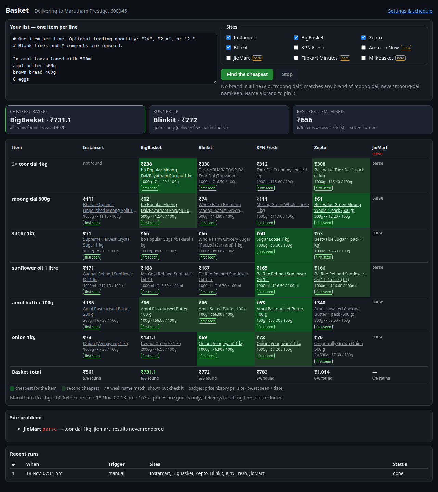

# Basket

You give it a grocery list. It checks **Instamart, BigBasket, Zepto, Blinkit, KPN Fresh, JioMart and Flipkart Minutes** at your delivery location and normalizes pack sizes. It tells you which site is cheapest for the **whole basket** and for **each item**. It remembers the **lowest price each site has ever shown** for every item, with the date.

**Searching a list is history-first.** It shows the last saved price for each item and site, tagged `as of dd/mm/yy`, without contacting any site. Press **Get fresh prices** to check them live. The scheduled runs keep the saved prices current.

It runs as an always-on service, natively or in Docker. You get a web page for ad-hoc lists, and the configured list is checked on a schedule (once or twice a day per site). That way the time-of-day deals on Instamart and BigBasket are caught, and you can see whether today's price is the best so far.



- **No logins and no pasted tokens.** Every site is used as a guest. One warm headless Chrome keeps a tab per site with your location set. Each search is the site's own API, called from inside that tab. Sessions refresh themselves.
- **Specific errors, never just "offline".** Each failure is reported per site as one of these kinds: `blocked` (bot wall or rate limit), `session`, `unserviceable`, `timeout`, `parse`, `not_found` or `browser`. The site's own message comes with it.
- **Generic lines match any brand.** `moong dal` matches any brand of moong dal, but never moong dal namkeen. `amul butter` only matches Amul.

---

## Quick start

### Docker (recommended: always on, restarts with the machine)

```bash
mkdir -p ~/basket-data            # results, history, config, browser profile
docker compose up -d --build      # http://localhost:7777  (settings: /settings)
node scripts/verify-runs.js       # did today's scheduled runs happen?
```

`docker compose` needs the compose plugin. With plain `docker` the equivalent is:

```bash
docker build -t comparebasket:latest .
docker run -d --name basket --restart unless-stopped -p 127.0.0.1:7777:7777 \
  -v ~/basket-data:/data -e TZ=Asia/Kolkata --shm-size=1g comparebasket:latest
```

### Native

Requires Node ≥ 22.13 and Google Chrome or Chromium. If Chrome isn't on `PATH`, set `CHROME_PATH`.

```bash
npm install
node src/cli.js serve             # service: UI + API + scheduler (data in ~/.basket)
node src/cli.js basket.txt --ui   # one-shot comparison in the terminal
```

---

## Using it

| Command | What it does |
|---|---|
| `basket serve [--port=7777] [--host=127.0.0.1] [--open]` | The service: web UI, JSON API, scheduler, history |
| `basket run-now [--sites=a,b]` | Queue the configured list on the running service. It runs locally if no service answers. |
| `basket history "<item>"` | Lowest price per kg / L / pc seen on each site, with date and product |
| `basket <file\|"items"> [--ui\|--json\|--web]` | One-shot live comparison |
| `basket <file\|"items"> --cached` | Same view built from saved prices only, dated; no site contacted |
| `basket search "<item>" [--json]` | One item across sites |
| `basket fees --set <site> --delivery 25 --handling 9 --free-above 199` | Optional delivery fees. Totals are goods-only otherwise. |

`basket` is `node src/cli.js` (or `npm i -g .`). Common flags:
- `--platforms=instamart,bigbasket,zepto,blinkit,kpn`
- `--json` (machine-readable output)
- `--ui` (boxed terminal view)

**List format:** one item per line, with an optional quantity (`2x toor dal 1kg`). Blank lines and lines starting with `#` are ignored.

### Web UI

**`/` (compare page)**
1. Paste a list and tick the sites.
2. Press **Find the cheapest**. This answers at once from **saved prices**: each cell is tagged `as of dd/mm/yy`, items with nothing saved say *no saved price*, and a banner says no site was contacted.
3. Type in **Check a saved price** (e.g. `onion`) for suggestions, then see what each site charged, per 100 g, with dates and the lowest rate seen.
4. Press **Get fresh prices** to check the sites live. If a site was searched moments ago (or is resting after a block), a countdown ("wait 3s…") appears and the run starts by itself.
5. Press **Sign in…** for Milkbasket, Zepto or Amazon: enter the mobile number, then the OTP. The session is kept in the service's browser profile. Each site shows a progress chip, e.g. `BigBasket · 3/5 · moong dal`. When it finishes the chip shows ✓, or ✖ with the exact reason.

The comparison table:
- Items are rows and sites are columns. Text wraps, so all columns fit with no horizontal scroll at 1280 px with 6+ sites.
- The cheapest cell for each item is **dark green** and the second cheapest is **light green**.
- Each cell shows the price, product, pack and per-unit price, plus a history badge (`new low (was ₹74/kg 12 Nov)`, `at lowest`, `+₹6 vs low`).
- Below 700 px wide, each item becomes a card with its sites sorted by price.

The three verdict boxes above the table show the cheapest single site, the runner-up, and the cheapest mix if you buy each item wherever it's cheapest.

**`/settings`:** edit the location, default sites, default list and schedules (HH:MM, any number per day, each with its own sites). There's also a **Run the list now** button.

There is no login: bind to localhost only (see [Security](#security)).

---

## Configuration

Config lives in `<data>/config.json` (`~/.basket` natively, `~/basket-data` in Docker). You can edit it at `/settings`, and missing keys fall back to defaults.

```json
{
  "location": {
    "lat": 12.9161793, "lng": 80.0975106, "pincode": "600045",
    "label": "Marutham Prestige", "searchText": "Marutham Prestige Tambaram",
    "address": "Marutham Prestige, Bharathidasan Nagar, Krishna Nagar, Tambaram, Chennai, Tamil Nadu 600045, India"
  },
  "sites": ["instamart", "bigbasket", "zepto", "blinkit", "kpn", "jiomart", "flipkart_minutes"],
  "basket": "2x toor dal 1kg\nmoong dal 500g\n…",
  "schedules": [
    { "name": "daily-check", "sites": ["instamart", "bigbasket", "zepto", "blinkit", "kpn", "jiomart", "flipkart_minutes"], "times": ["07:00", "09:00", "12:00"] }
  ],
  "timezone": "Asia/Kolkata",
  "server": { "host": "127.0.0.1", "port": 7777 }
}
```

How each site gets the location:
- **Instamart and Blinkit** get the coordinates as cookies.
- **BigBasket and Zepto** get `searchText` typed into their own address picker, once. The choice is remembered in the browser profile.
- **KPN** has no guest location picker, so it uses its Chennai default.
- **JioMart** gets the pincode, city and state (from the address) as cookies and request headers.
- **Flipkart Minutes** gets `searchText` typed into its address picker once.

Changing the location in settings re-locates every site on the next run.

---

## Sites

| Site | How | Location | Notes |
|---|---|---|---|
| Instamart | in-page `POST /api/instamart/search/v2` | `userLocation` cookie | Rate-limits bursts (a 200 response with `{"statusCode":429}`). Searches are paced 2.5 s apart. |
| BigBasket | in-page `GET /listing-svc/v2/products` | guest address picker → `_bb_pin_code` | Guest only. Akamai blocks Node fetch and mismatched UAs. ₹1 promo rows are ignored. |
| Zepto | in-page `GET bff-gateway…/search-federator-service/api/v1/search` | address picker → `user_position` cookie | Its headers (store ids, csrf, signature) are copied from the page's own request. **Since 2026-11-19 it asks for sign-in to search at Krishna Nagar**; use *Sign in…*. |
| Blinkit | in-page `POST /v1/layout/search` | `gr_1_lat`/`gr_1_lon` cookies | Its headers (auth_key, device id) are copied from the page's own request. |
| KPN Fresh | `/search?q=` HTML → `__NEXT_DATA__` | Chennai default | One row per pack (250 g / 500 g / 1 kg). |
| JioMart | in-page `GET /api/service/application/catalog/v1.0/products` (groceries, standard delivery) | `app_location_details` / `app_geolocation` cookies and `x-location-detail` headers, built from config | Quick-delivery prices aren't used: their store ids come only from a signed call. |
| Flipkart Minutes | `/search?q=&marketplace=HYPERLOCAL` HTML → `__INITIAL_STATE__` | guest address picker, once | The guest session keeps the address (its cookies last 6–12 months). |
| Amazon Now | in-page `GET /tez/browse/searchByKeyword` | pincode via Amazon's `glow/address-change` | **Doesn't deliver to 600045** (its own `validateLocation` says `isServiceable: false`), so it's reported as `unserviceable`. Opt-in. |
| Milkbasket | **skipped** | — | Needs a login: guests are fixed to its default city. A web login exists (mobile + OTP at `/login`); supporting it needs one OTP login. |

Details on how the engine works, how errors are classified, and how to add a site: **[docs/ENGINE.md](docs/ENGINE.md)**.

---

## Matching and totals

- **Which product, not just which category.** `toor dal` needs "toor" in the name, and never takes Moong Dal just because both say "dal". Regional names are folded in: Arhar, Tur and Thuvaram are toor; Mung, Hesaru and Payatham are moong; Dhall and Paruppu are dal; Vengayam is onion.
- **Multipacks count in full.** `80g x4`, `80gx4` and `Pack of 4 (80 g each)` are 320 g, and the per-100 g rate uses that.
- **Price check.** For each item, a site's price per unit is compared with the median across sites. Anything below 40% or above 2.5× is left out, the site's next candidate is tried, and the page lists what was left out and why (e.g. a 100 g butter block listed as 500 g).
- **Size asked for.** A pack more than 1.5× the size asked for (a 12-pack for "6 eggs", a 5 L can for "1L") is shown, greyed, with its rate, but not totalled. Approximate produce weights ("Approx. 900 g – 1000 g") count as 1 kg. Quantity folds into the amount: "2× milk 500ml" can be one 1 L pack. Different forms are refused: tomato ≠ ketchup or powder, onion ≠ spring onion.
- **Generic vs brand.** If a line names no brand, any brand qualifies and the cheapest per unit wins. If it names a brand (`amul butter`), any other brand is refused. Snack and other category words the query didn't ask for are refused too (`moong dal` ≠ *Moong Dal Namkeen*, `butter` ≠ *Butter Cookies*).
- **Below confidence 0.55** a match is shown with `?` and never silently trusted.
- **Packs actually needed are bought.** Asking for 1 kg when only 500 g is stocked charges 2 × 500 g.
- **Ranking:**
  - Complete baskets win.
  - If none is complete, the comparison uses only the items every site stocked, and says so.
  - A site that failed still appears in the table with its error, so it is never mistaken for an expensive one.
- **Totals are goods only** until you set fees (`basket fees`). The output always says which.

---

## History and scheduled runs

- Every finished job, manual or scheduled, records each confidently matched line in `<data>/basket.db` (SQLite). Prices are kept **per kg / L / pc**, and units never mix.
- Each job is also written to `<data>/results/<timestamp>-job<id>-<trigger>.json`, and one summary line is appended to `<data>/results/runs.jsonl`.
- `node scripts/verify-runs.js [dataDir] [--date=YYYY-MM-DD]` checks that each scheduled time produced a run, and prints each site's outcome and new lows.

Operations, monitoring and troubleshooting: **[docs/OPERATIONS.md](docs/OPERATIONS.md)**. HTTP API and SSE events: **[docs/API.md](docs/API.md)**.

---

## Security

- The UI and API have **no authentication**. `POST /api/compare` makes the service browse sites on your behalf.
  - Natively the server binds `127.0.0.1`.
  - In Docker it listens on `0.0.0.0` inside the container, but compose publishes it on `127.0.0.1:7777` only.
  - Opening it to your LAN (`"7777:7777"`) lets anyone on that network run jobs and change the config.
- In Docker, Chrome runs with `--no-sandbox` (`BASKET_CHROME_NO_SANDBOX=1`), because Docker blocks the user namespaces its sandbox needs. The container runs as the unprivileged `node` user with no added capabilities, and that is the isolation boundary.
- No cookies or tokens are stored in source. Sessions live only in the browser profile under the data directory.

---

## MCP

```bash
claude mcp add basket -- node /path/to/comparebasket/src/mcp-server.js
```

The tools are `compare_basket`, `search_product`, `open_basket_view` and `open_platform`. They call the same `compareBasket()`, so they get the same engine, errors and numbers.

---

## Development

```bash
npm test                 # 184 offline tests (fixtures under test/fixtures/sites)
npm run test:live        # LIVE=1 searches against the real sites (needs Chrome + network)
node scripts/mcp-smoke.js
```

| Path | Job |
|---|---|
| `src/compare.js` | `compareBasket()`, the single entry point (CLI, server, jobs, MCP) |
| `src/engine/` | Chrome launcher, CDP tab, browser pool, self-healing runner, error kinds |
| `src/engine/sites/` | One module per site (`search`, `parse`, location) |
| `src/normalize.js`, `src/score.js` | Pack parsing, match confidence, best pick, ranking |
| `src/store.js` | SQLite price history and jobs |
| `src/jobs.js`, `src/scheduler.js`, `src/service.js` | Queue, daily-times scheduler, the long-running service |
| `src/server.js`, `src/ui/` | HTTP API with SSE, compare and settings pages |
| `src/extract/` | Legacy DOM extractors, used as page fallbacks and by the webcmd backend |
| `docs/` | Design, plan, diagnosis, engine/API/ops guides, UI evidence |

The legacy backends are still selectable: `BASKET_BACKEND=webcmd` (webcmd adapters, `basket setup` / `doctor`) and `BASKET_BACKEND=cdp` (a Chrome you started on port 9222).

## License

MIT
