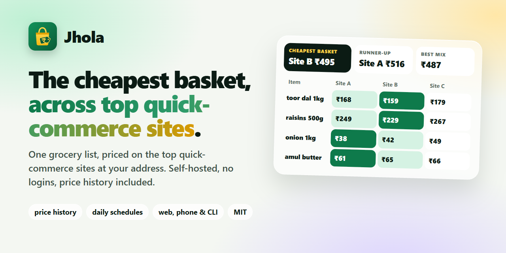
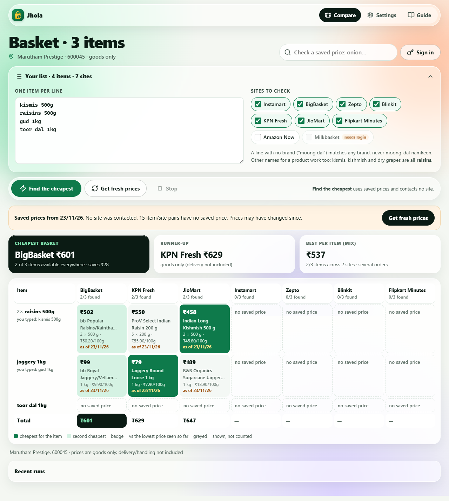
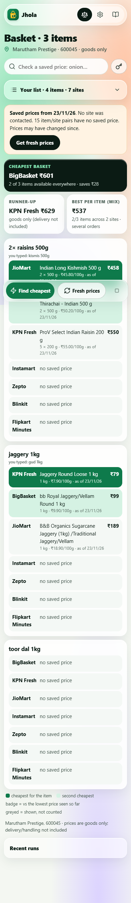

<div align="center">



# Jhola

**Write your grocery list once. See where the whole basket, and each item, costs least.**

Checks the top quick-commerce sites at your delivery address. Self-hosted, no logins, with price history and daily schedules.

[](LICENSE)
[](package.json)
[](Dockerfile)
[](https://github.com/harivig12/jhola/stargazers)
[](https://github.com/harivig12/jhola/commits)

[**Guide and landing page**](https://harivig12.github.io/jhola/) · [Quick start](#quick-start) · [Features](#features) · [Docs](#documentation) · [Changelog](CHANGELOG.md) · [Contributing](CONTRIBUTING.md)

</div>

---

## What it does

You give it a grocery list. It checks the top quick-commerce sites at your address, normalizes pack sizes, and tells you:

- which site is cheapest for the **whole basket**,
- which site is cheapest for **each item**,
- the **lowest price each site has ever shown** for every item, with the date.

Searching is **history-first**: it answers at once from saved prices, each tagged `as of dd/mm/yy`, without contacting any site. Press **Get fresh prices** to check them live. Scheduled runs keep the saved prices current, so deals that some sites run at set times of day are caught.

<p align="center">
  
</p>

## Features

| | |
|---|---|
| **Top quick-commerce sites, no logins** | Sites are used as a guest wherever they allow it. One warm headless Chrome keeps a tab per site with your location set. Each search is the site's own API, called from inside that tab. |
| **One product, many names** | A catalogue of about 230 products. `kismis`, `kishmish` and `dry grapes` are all `raisins`; `gud`, `vellam` and `jagrey` are all `jaggery`. They share one row and one price history. |
| **Brand-aware matching** | `moong dal` matches any brand, but never moong dal namkeen. `amul butter` only matches Amul. Weak matches are shown with a `?`, never silently totalled. |
| **Price history** | The lowest price per kg / L / piece for every item and site, with the date. Badges show new lows and how far a price is from its low. |
| **Schedules and a sweep** | Check your list at the times you choose. A background sweep fills in products nobody has searched yet, a few at a time at random gaps. |
| **Specific errors** | Every failure names its kind (`blocked`, `session`, `unserviceable`, `timeout`, `parse`, `not_found`, `browser`) with the site's own message, never just "offline". |
| **Website, phone, CLI, MCP** | A responsive web page, a command-line tool called `jhola`, and an MCP server for AI assistants. They all use the same engine, so they show the same numbers. |

<p align="center">
  
</p>

## Quick start

**Docker** (recommended: always on, restarts with the machine)

```bash
git clone https://github.com/harivig12/jhola.git
cd jhola
mkdir -p ~/basket-data
docker compose up -d --build        # http://localhost:7777
```

**Without Docker** (Node 22.13 or newer, and Google Chrome or Chromium)

```bash
cd jhola
npm install
node src/cli.js serve               # http://localhost:7777
```

Then open <http://localhost:7777>, paste a list, and press **Find the cheapest**. If Chrome isn't on your `PATH`, set `CHROME_PATH`.

The in-app guide at `/guide` covers the website and phone steps, including how to open it from a phone on your home Wi-Fi. The same page is published as the [landing page](https://harivig12.github.io/jhola/).

## Documentation

| Read | For |
|---|---|
| [`docs/USAGE.md`](docs/USAGE.md) | Everything about using it: commands, web page, configuration, matching rules |
| [`docs/ENGINE.md`](docs/ENGINE.md) | How sites are searched, the error kinds, and how to add or fix a site |
| [`docs/API.md`](docs/API.md) | The HTTP and SSE API |
| [`docs/OPERATIONS.md`](docs/OPERATIONS.md) | Running the service, schedules, sweep, phones, troubleshooting |
| [`AGENTS.md`](AGENTS.md) | Rules for contributors and coding agents |
| [`CHANGELOG.md`](CHANGELOG.md) | What changed in each release |

## Security

The web page and API have **no authentication**, because the service browses sites on your behalf. By default it listens on `127.0.0.1` only. If you open it to your home network so a phone can reach it, only do that on a network you trust, and never forward the port to the internet. See [SECURITY.md](SECURITY.md).

## Contributing

Bug reports, site fixes and new sites are welcome. [CONTRIBUTING.md](CONTRIBUTING.md) explains how to run the tests and what a good pull request looks like. Sites change their pages often, so a fix to one site module is the most useful kind of contribution.

## License

[MIT](LICENSE). Jhola is an independent project and is not affiliated with any of the sites it checks. Use it for your own shopping and respect each site's terms.
