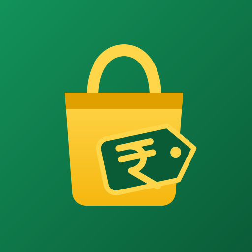

# Jhola brand

A *jhola* is the cloth shopping bag you carry to the market. The icon is a yellow jhola with a green ₹ price tag, on green: groceries, at the right price.

<p>
  
  &nbsp;
  
  &nbsp;
  
</p>

## Files

| File | What it is |
|---|---|
| [`jhola-icon.svg`](jhola-icon.svg) | **The master.** Edit this one and nothing else. |
| [`jhola-icon-1024.png`](jhola-icon-1024.png) | 1024 px export for stores, slides and social posts |
| `../../src/ui/icon.svg` | Exact copy, served as `/icon.svg` and used as the favicon and the top-bar mark |
| `../../src/ui/icon-180.png`, `icon-192.png`, `icon-512.png` | Home-screen icons (iPhone, and the web app manifest) |
| [`../../docs/assets/social-preview.html`](../../docs/assets/social-preview.html) → `.png` | The 1280×640 image used for link previews and the README banner |

After changing the master, run:

```bash
npm run build:icons      # copies the SVG and re-renders every PNG (needs Chrome)
```

`test/brand.test.js` fails if `src/ui/icon.svg` is not identical to the master, or if any PNG is the wrong size.

## Colours

| Role | Hex | Used for |
|---|---|---|
| Green, top | `#12925A` | Icon background (gradient start) |
| Green, bottom | `#0A5C37` | Icon background (gradient end), the price tag |
| Yellow, light | `#FFD54A` | Bag (gradient start), handles, ₹ |
| Yellow, deep | `#F5B70F` | Bag (gradient end) |
| Hem | `#E0A100` | The bag's folded top edge |
| App green | `#0E7A4B` | "Cheapest" cells and buttons in the app (`--g` in `src/ui/theme.css`) |
| Ink | `#0B1B14` | Text and the dark verdict box |

## Rules

- **Name:** write it **Jhola**, with a capital J. The command and package are `jhola` in lower case.
- **Shape:** the icon is a full-bleed square. Don't add your own border or shadow inside the file. Platforms round or mask it themselves, and the bag sits inside the area every mask keeps.
- **Size:** it is designed to work down to 16 px. Below 32 px the ₹ becomes a mark rather than a letter, which is expected.
- **Background:** don't recolour it, and don't place it on a busy photo. On light pages, give it a little space or a soft shadow, as the top bar does.
- **Pairing:** next to the name, use the icon at the height of the text's cap height × 2, with a gap of about a third of the icon's width.
