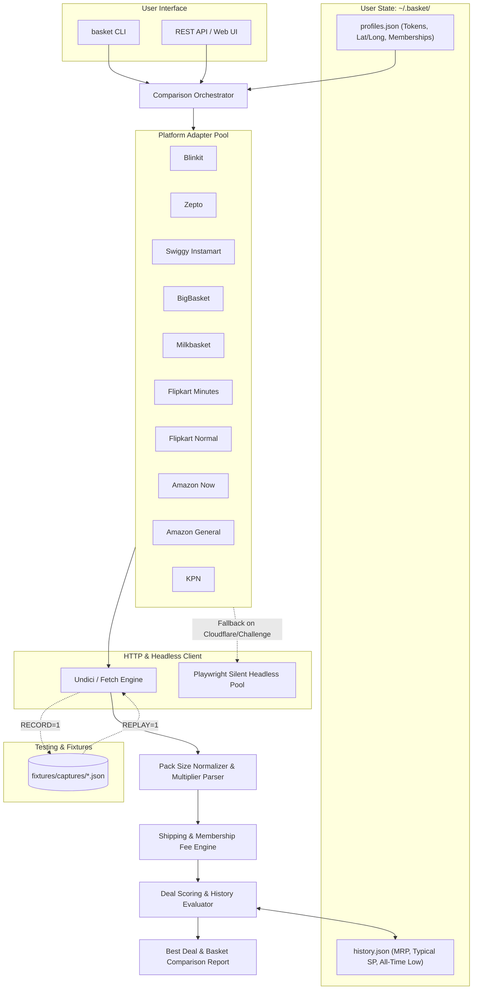

# Approved Design Doc: Headless On-Demand Price Comparison Engine & Deal Tracker

- **Date**: 2026-11-10
- **Status**: Approved
- **Runtime**: Node.js (ESM)
- **State Location**: `~/.basket/` (User Home Directory)

---

## 1. Intent & Overview

Build a fast, headless on-demand grocery and quick-commerce price comparison engine in Node.js. It queries multiple Indian platforms concurrently, uses persistent user profiles to check account-level tier discounts, tracks price history to detect true bargains, and records request/response fixtures for testing without opening visible browser windows.

---

## 2. Requirements & Agreed Decisions

### 2.1 Multi-Profile Strategy (Smart Single Query + Account Tier Overlay)
- **Catalog Query**: Products and base selling prices are fetched once per platform to avoid hammering APIs ($10$ calls per item instead of $10 \times N$).
- **Profile Discount Overlay**: If a platform offers profile-specific perks (e.g. VIP/Plus discounts, profile-specific coupons, or membership free shipping), the engine evaluates the candidate profiles and selects the profile that delivers the best net basket price.
- **Selective Multi-Account Query**: Only queries distinct accounts for platforms known to personalize item base prices (or when requested via `--deep-profile-check`).

### 2.2 Membership & Shipping Calculation
- User profiles store membership attributes:
  - `amazon_prime`: `true` / `false`
  - `flipkart_vip`: `true` / `false`
  - `swiggy_one`: `true` / `false`
  - `zepto_pass`: `true` / `false`
  - `blinkit_plus`: `true` / `false`
- Standard shipping charges for Amazon General and Flipkart Normal are evaluated against order value thresholds:
  - Amazon General: Free for Prime or on orders $\ge ₹499$; otherwise $+₹40$.
  - Flipkart Normal: Free for VIP/Plus or on orders $\ge ₹500$; otherwise $+₹40$.
- Quick-commerce delivery and handling fees use platform-specific rules (e.g., free delivery over ₹99/₹149/₹199 depending on platform and pass status).

### 2.3 Storage Location (`~/.basket/`)
All persistent runtime state and credentials live securely outside the repository root in the user's home directory:
- `~/.basket/profiles.json`: Authenticated sessions, tokens, delivery addresses (lat/long/pincode), and membership flags.
- `~/.basket/history.json`: Master price history catalog with historical MRP, typical selling price (`typical_sp`), and all-time low (`all_time_low`).
- `fixtures/captures/<platform>/<query_slug>.json`: In-repo sanitized request/response test fixtures for replay testing (PII and auth credentials scrubbed).

### 2.4 Platforms Covered (10 Platforms)
1. **Milkbasket** (Delivery hub/society context + morning slot)
2. **Swiggy Instamart** (Direct mobile/web API)
3. **Zepto** (Direct API)
4. **Blinkit** (Direct API)
5. **BigBasket** (Direct API / BB Now)
6. **Flipkart Minutes** (Direct API / Hyperlocal)
7. **Flipkart Normal** (Factoring delivery fee + Flipkart VIP)
8. **Amazon Now / Fresh** (Direct/Headless API)
9. **Amazon General** (Factoring delivery fee + Amazon Prime)
10. **KPN** (Kannan Departmental / Farm Fresh regional API)

---

## 3. System Architecture



---

## 4. Subsystems Detail

### 4.1 One-Time Profile Setup (`~/.basket/profiles.json`)
Interactive OTP handshake:
```bash
basket profile login --platform=zepto --phone=9876543210
# 1. Sends OTP via API
# 2. Prompts user for OTP
# 3. Saves bearer token, refresh token, address, lat/long, pincode
```
Schema:
```json
{
  "profiles": [
    {
      "id": "profile_primary",
      "phone": "+919876543210",
      "memberships": {
        "amazon_prime": true,
        "flipkart_vip": false,
        "zepto_pass": true,
        "swiggy_one": false
      },
      "location": {
        "pincode": "560102",
        "latitude": 12.9165,
        "longitude": 77.6528,
        "address": "HSR Layout, Bangalore"
      },
      "sessions": {
        "zepto": { "token": "Bearer eyJ...", "expires_at": 1780000000 },
        "blinkit": { "token": "...", "cookies": "..." },
        "swiggy": { "token": "...", "tid": "..." }
      }
    }
  ]
}
```

### 4.2 Test & Replay Harness (`RECORD=1` / `REPLAY=1`)
- Outbound requests route through an interceptor.
- Fixture files are saved deterministically: `fixtures/captures/<platform>/<query_slug>.json`.
- **Sanitization**: Before writing to disk, `Authorization`, `cookie`, `set-cookie`, phone numbers, exact addresses, and high-precision GPS coordinates are stripped/masked.
- **Replay**: In test mode, network calls are intercepted and served from local JSON fixtures.

### 4.3 Deal Intelligence (`~/.basket/history.json`)
Tracks price movements per canonical SKU:
- `mrp`: Maximum Retail Price.
- `typical_sp`: Rolling median of observed selling prices.
- `all_time_low`: Lowest confirmed valid selling price.
- **Tags**:
  - `BEST_PRICE_EVER`: Price $\le$ `all_time_low`.
  - `SOLID_DISCOUNT`: Price $\le$ `typical_sp * 0.90` ($\ge 10\%$ discount over normal selling price).
  - `REGULAR`: Normal prevailing price.

---

## 5. Scope & Phases (Planning Only - No Execution in Codebase Yet)

1. **Phase 1: Foundation & Profile Engine**
   - Profile & session manager storing credentials in `~/.basket/profiles.json`.
   - Membership flag support (Prime, VIP, Passes).
   - HTTP interceptor with deterministic `RECORD`/`REPLAY` fixture persistence and PII scrubbing.

2. **Phase 2: Platform Adapters (Wave 1: Quick Commerce)**
   - Blinkit, Zepto, Swiggy Instamart, BigBasket, Milkbasket.
   - Headless background fallback for bot-guarded token handshakes.

3. **Phase 3: Platform Adapters (Wave 2: E-Commerce & Fresh)**
   - Amazon Now / Fresh, Amazon General (with shipping fee calculation).
   - Flipkart Minutes, Flipkart Normal (with shipping fee calculation), KPN.

4. **Phase 4: Normalization, Scoring & API Server**
   - Pack size normalization with multipack multiplier handling.
   - History tracker in `~/.basket/history.json` and deal tagger.
   - High-speed REST API endpoint (`POST /api/compare`) accepting product lists.
