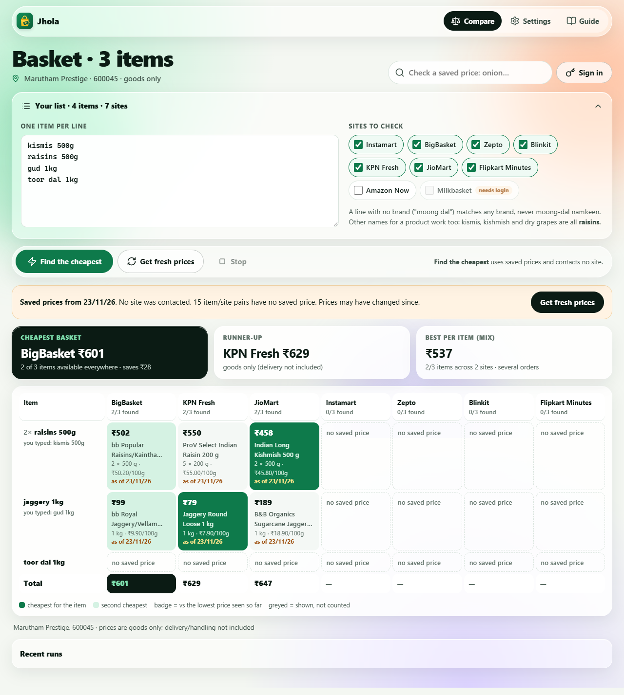

# Using Jhola

[← Back to the project README](../README.md)

You give it a grocery list. It checks **the top quick-commerce sites** at your delivery location and normalizes pack sizes. It tells you which site is cheapest for the **whole basket** and for **each item**. It remembers the **lowest price each site has ever shown** for every item, with the date.

**Searching a list is history-first.** It shows the last saved price for each item and site, tagged `as of dd/mm/yy`, without contacting any site. Press **Get fresh prices** to check them live. The scheduled runs keep the saved prices current.

It runs as an always-on service, natively or in Docker. You get a web page for ad-hoc lists, and the configured list is checked on a schedule (once or twice a day per site). That way deals that some sites run at set times of day are caught, and you can see whether today's price is the best so far.



- **No logins and no pasted tokens.** Every site is used as a guest. One warm headless Chrome keeps a tab per site with your location set. Each search is the site's own API, called from inside that tab. Sessions refresh themselves.
- **Specific errors, never just "offline".** Each failure is reported per site as one of these kinds: `blocked` (bot wall or rate limit), `session`, `unserviceable`, `timeout`, `parse`, `not_found` or `browser`. The site's own message comes with it.
- **Generic lines match any brand.** `moong dal` matches any brand of moong dal, but never moong dal namkeen. `amul butter` only matches Amul.
- **One product, many names.** `kismis`, `kishmish` and `dry grapes` are all `raisins`; `gud`, `vellam` and `jagrey` are all `jaggery`. They share one row and one price history (see [Names and synonyms](#names-and-synonyms)).
- **A sweep that fills the gaps.** In the background it prices catalogue products nobody has searched yet, a few at a time at random gaps (see [Catalogue sweep](#catalogue-sweep)).

---

The web app is called **Jhola** (the market bag): one list, every app, the cheapest bag. Open it on a phone and use "Add to home screen" to install it with its icon.

## Quick start

### Docker (recommended: always on, restarts with the machine)

```bash
mkdir -p ~/basket-data            # results, history, config, browser profile
docker compose up -d --build      # http://localhost:7777  (settings: /settings)
node scripts/verify-runs.js       # did today's scheduled runs happen?
```

`docker compose` needs the compose plugin. With plain `docker` the equivalent is:

```bash
docker build -t jhola:latest .
docker run -d --name jhola --restart unless-stopped -p 127.0.0.1:7777:7777 \
  -v ~/basket-data:/data -e TZ=Asia/Kolkata --shm-size=1g jhola:latest
```

### Native

Requires Node ≥ 22.13 and Google Chrome or Chromium. If Chrome isn't on `PATH`, set `CHROME_PATH`.

```bash
npm install
node src/cli.js serve             # service: UI + API + scheduler (data in ~/.basket)
node src/cli.js basket.txt --ui   # one-shot comparison in the terminal
```

---

## Using it

| Command | What it does |
|---|---|
| `jhola serve [--port=7777] [--host=127.0.0.1] [--open]` | The service: web UI, JSON API, scheduler, history |
| `jhola run-now [--sites=a,b]` | Queue the configured list on the running service. It runs locally if no service answers. |
| `jhola history "<item>"` | Lowest price per kg / L / pc seen on each site, with date and product |
| `jhola catalog ["<item>"] [--category=spices]` | What a word resolves to (`kismis` → `raisins`), or the products in a category |
| `jhola sweep-now` | Queue one catalogue sweep batch on the running service |
| `jhola <file\|"items"> [--ui\|--json\|--web]` | One-shot live comparison |
| `jhola <file\|"items"> --cached` | Same view built from saved prices only, dated; no site contacted |
| `jhola search "<item>" [--json]` | One item across sites |
| `jhola fees --set <site> --delivery 25 --handling 9 --free-above 199` | Optional delivery fees. Totals are goods-only otherwise. |

`jhola` is `node src/cli.js` (or `npm i -g .`). The old command name `basket` still works. Common flags:
- `--platforms=instamart,bigbasket,zepto,blinkit,kpn`
- `--json` (machine-readable output)
- `--ui` (boxed terminal view)

**List format:** one item per line, with an optional quantity (`2x toor dal 1kg`). Blank lines and lines starting with `#` are ignored.

### Web UI

**`/` (compare page)**
1. Paste a list and tick the sites.
2. Press **Find the cheapest**. This answers at once from **saved prices**: each cell is tagged `as of dd/mm/yy`, items with nothing saved say *no saved price*, and a banner says no site was contacted.
3. Type in **Check a saved price** (e.g. `onion`). Suggestions show the best saved rate. The answer has one row per site, cheapest first (in green): the rate on the **last 3 dates that have data** with small bars (`6.55 → 6.55 → 6.90`), today's rate with ▼/▲, and the lowest rate ever seen.
4. Press **Get fresh prices** to check the sites live. If a site was searched moments ago (or is resting after a block), a countdown ("wait 3s…") appears and the run starts by itself. Each site shows a progress chip, e.g. `BigBasket · 3/5 · moong dal`. When it finishes the chip shows ✓, or ✖ with the exact reason.
5. Press **Sign in…** for Milkbasket, Zepto, Instamart or Amazon (Instamart is optional; without it, it searches as a guest):
   - Pick the site, enter the mobile number, press **Send OTP**.
   - When the site has sent it, an OTP box appears and the button becomes **Verify**. *Change number* goes back; *Resend OTP* unlocks after 30 s (3 requests per site per hour).
   - **Amazon uses a password.** Enter the account's mobile number or email and press **Continue**, then the password, then **Sign in**. If Amazon then asks for a verification code, a code box appears; if it sends an approval request to your phone, approve it and press **Check**. A puzzle (CAPTCHA) can't be solved here: sign in once at amazon.in in a normal browser and try again later. After 3 wrong passwords it stops, so the account isn't locked. The password isn't saved or logged (Chrome's password manager is off in this profile).
   - The session is kept in the service's browser profile. Amazon Now's guest check says it doesn't deliver to 600045, so it may still show no prices after you sign in, unless the account's saved address is covered.
   - **More than one account (Instamart, Milkbasket):** each site lists its accounts. Press **+ Add account**, give it a name (e.g. "Amma", shown on hover), then the number and OTP. Each account gets its own browser profile, so device ids never mix; up to 3 per site. Instamart searches every signed-in account and keeps the cheapest (hover the price to see which account). Milkbasket's extra accounts are checked for deals only. **Sign out** (main) clears just that site; **Remove** (extra) deletes the account's profile.
   - **BigBasket** sign-in is optional; if BigBasket shows its bot-protection page, the sign-in stops and searches stay guest.
6. **Deals · 80%+ off** at the bottom: products at 80% or more off MRP (like Milkbasket's ₹1 vegetables), grouped by site with their conditions (max quantity, minimum basket). Hover a row for the accounts that saw it. Deals never count in a total. They refresh at 07:00 and 18:00 (an offer check per account, no product search; `deals.times` in config) or when you press **Check offers**. The threshold is `deals.minDiscountPct` in config.
7. **cheaper: …** inside a cell: you asked for a brand (e.g. tata salt) and that site has a cheaper product of the same kind from another brand. The total stays on your brand; the hint shows the name, price and rate. **Add a price** records what you paid or saw elsewhere (item, price, pack, date, shop); it shows as an **Others** column (shop on hover) and in lookups, and counts in "Best per item". The saved-price lookup has a **Pack price** column next to the rate trend.
8. **Get for missing only** (next to Get fresh prices) searches just the item/site pairs that have no saved price, then shows the list again.
8. **✕** next to a product name in a cell: that product is the wrong match for the item. Its saved prices are deleted and it's never picked for that item on that site again.
9. **Free delivery** row under Total: each site's own free-delivery minimum (from the offer check) and "✓ free" or "₹X more" for that column's total. Green shades mark the cheapest **per 100 g / 100 ml / piece**, not the pack price.
10. **☀ / ☾ / Auto** in the header switches light and dark. Auto follows the system and is the default; the choice is remembered per browser.

The comparison table:
- Items are rows and sites are columns. Text wraps, so all columns fit with no horizontal scroll at 1280 px with 6+ sites.
- The cheapest cell for each item is **dark green** and the second cheapest is **light green**.
- Each cell shows the price, product, pack and per-unit price, plus a history badge (`new low (was ₹74/kg 12 Nov)`, `at lowest`, `+₹6 vs low`).
- ▼ (green) or ▲ (red) next to a price compares it with the latest earlier saved price for that site, even one from the same day. Changes under 1% show no arrow.
- Below 700 px wide, each item becomes a card with its sites sorted by price.

The three verdict boxes above the table show the cheapest single site, the runner-up, and the cheapest mix if you buy each item wherever it's cheapest.

**`/settings`:** edit the location, default sites, default list and schedules (HH:MM, any number per day, each with its own sites). There's also a **Run the list now** button. It shares the theme toggle with the compare page.

**`/guide`:** a step-by-step guide with separate website and phone tracks, a box to try the synonyms, and a table of error kinds. The same page is published as the [public landing page](https://harivig12.github.io/jhola/) (`npm run build:site`). On a phone, open the service from your home Wi-Fi and use *Add to Home screen* (see [Using it from a phone](OPERATIONS.md#using-it-from-a-phone)).

There is no login: bind to localhost only (see [Security](#security)).

---

## Configuration

Config lives in `<data>/config.json` (`~/.basket` natively, `~/basket-data` in Docker). You can edit it at `/settings`, and missing keys fall back to defaults.

```json
{
  "location": {
    "lat": 12.9161793, "lng": 80.0975106, "pincode": "600045",
    "label": "Marutham Prestige", "searchText": "Marutham Prestige Tambaram",
    "address": "Marutham Prestige, Bharathidasan Nagar, Krishna Nagar, Tambaram, Chennai, Tamil Nadu 600045, India"
  },
  "sites": ["instamart", "bigbasket", "zepto", "blinkit", "kpn", "jiomart", "flipkart_minutes"],
  "basket": "2x toor dal 1kg\nmoong dal 500g\n…",
  "schedules": [
    { "name": "daily-check", "sites": ["instamart", "bigbasket", "zepto", "blinkit", "kpn", "jiomart", "flipkart_minutes"], "times": ["07:00", "09:00", "12:00"] }
  ],
  "timezone": "Asia/Kolkata",
  "server": { "host": "127.0.0.1", "port": 7777 },
  "sweep": { "enabled": true, "sites": [], "minItems": 2, "maxItems": 4, "minGapMinutes": 5, "maxGapMinutes": 20, "staleHours": 24 },
  "deals": { "minDiscountPct": 80, "times": ["07:00", "18:00"] },
  "browser": { "idleCloseMs": 300000, "blockMedia": true },
  "results": { "keepDays": 60 }
}
```

`browser.idleCloseMs` closes Chrome after 5 idle minutes (`0` keeps it on), `browser.blockMedia` skips images and fonts on search tabs, and `results.keepDays` prunes old per-run JSON files. See [docs/OPERATIONS.md](docs/OPERATIONS.md#resource-use-and-retention).

How each site gets the location:
- **Instamart and Blinkit** get the coordinates as cookies.
- **BigBasket and Zepto** get `searchText` typed into their own address picker, once. The choice is remembered in the browser profile.
- **KPN** has no guest location picker, so it uses its Chennai default.
- **JioMart** gets the pincode, city and state (from the address) as cookies and request headers.
- **Flipkart Minutes** gets `searchText` typed into its address picker once.

Changing the location in settings re-locates every site on the next run.

---

## Sites

| Site | How | Location | Notes |
|---|---|---|---|
| Instamart | in-page `POST /api/instamart/search/v2` | `userLocation` cookie | Rate-limits bursts (a 200 response with `{"statusCode":429}`). Searches are paced 2.5 s apart. |
| BigBasket | in-page `GET /listing-svc/v2/products` | guest address picker → `_bb_pin_code` | Guest only. Akamai blocks Node fetch and mismatched UAs. ₹1 promo rows are ignored. |
| Zepto | in-page `GET bff-gateway…/search-federator-service/api/v1/search` (guest), or `POST …/user-search-service/api/v3/search` (signed in) | address picker → `user_position` cookie | Its headers (store ids, csrf, signature) and, signed in, its request body are copied from the page's own request. **Since 2026-11-19 it asks for sign-in to search at Krishna Nagar**; use *Sign in…*. |
| Blinkit | in-page `POST /v1/layout/search` | `gr_1_lat`/`gr_1_lon` cookies | Its headers (auth_key, device id) are copied from the page's own request. |
| KPN Fresh | `/search?q=` HTML → `__NEXT_DATA__` | Chennai default | One row per pack (250 g / 500 g / 1 kg). |
| JioMart | in-page `GET /api/service/application/catalog/v1.0/products` (groceries, standard delivery) | `app_location_details` / `app_geolocation` cookies and `x-location-detail` headers, built from config | Quick-delivery prices aren't used: their store ids come only from a signed call. |
| Flipkart Minutes | `/search?q=&marketplace=HYPERLOCAL` HTML → `__INITIAL_STATE__` | guest address picker, once | The guest session keeps the address (its cookies last 6–12 months). |
| Amazon Now | in-page `GET /tez/browse/searchByKeyword` | pincode via Amazon's `glow/address-change` | **Doesn't deliver to 600045** (its own `validateLocation` says `isServiceable: false`), so it's reported as `unserviceable`. Opt-in. |
| Milkbasket | **signed in only**: GraphQL catalogue (`getProductCategories` → `getCatalogProductList` per subcategory), read once a day and matched locally; flash deal for Deals | the account's society (its saved hub) | Guests are fixed to its default city. The first search of the day reads ~6,200 products in ~4 min (paced); later ones are instant from `<data>/cache/`. Extra accounts only check deals. |

Details on how the engine works, how errors are classified, and how to add a site: **[docs/ENGINE.md](ENGINE.md)**.

---

## Matching and totals

- **Which product, not just which category.** `toor dal` needs "toor" in the name, and never takes Moong Dal just because both say "dal". Regional names are folded in: Arhar, Tur and Thuvaram are toor; Mung, Hesaru and Payatham are moong; Dhall and Paruppu are dal; Vengayam is onion.
- **Multipacks count in full.** `80g x4`, `80gx4` and `Pack of 4 (80 g each)` are 320 g, and the per-100 g rate uses that.
- **Price check.** For each item, a site's price per unit is compared with the median across sites. Anything below 40% or above 2.5× is left out, the site's next candidate is tried, and the page lists what was left out and why (e.g. a 100 g butter block listed as 500 g).
- **Size asked for.** A pack more than 1.5× the size asked for (a 12-pack for "6 eggs", a 5 L can for "1L") is shown, greyed, with its rate, but not totalled. Approximate produce weights ("Approx. 900 g – 1000 g") count as 1 kg. Quantity folds into the amount: "2× milk 500ml" can be one 1 L pack. Different forms are refused: tomato ≠ ketchup or powder, onion ≠ spring onion.
- **Generic vs brand.** If a line names no brand, any brand qualifies and the cheapest per unit wins. If it names a brand (`amul butter`), any other brand is refused. Snack and other category words the query didn't ask for are refused too (`moong dal` ≠ *Moong Dal Namkeen*, `butter` ≠ *Butter Cookies*).
- **Below confidence 0.55** a match is shown with `?` and never silently trusted.
- **Packs actually needed are bought.** Asking for 1 kg when only 500 g is stocked charges 2 × 500 g.
- **Ranking:**
  - Complete baskets win.
  - If none is complete, the comparison uses only the items every site stocked, and says so.
  - A site that failed still appears in the table with its error, so it is never mistaken for an expensive one.
- **Totals are goods only** until you set fees (`jhola fees`). The output always says which.

---

## Names and synonyms

About 230 products are listed as synonym sets in `src/catalog-data.js`: a canonical tag, English, Hindi, Tamil, Telugu and Kannada names, common misspellings, narrower names (`salted butter`), brand facets and a category (`staples`, `pulses`, `spices`, `masala`, `oil`, `dairy`, `sweetener`, `dry-fruits`, `snacks`, `beverages`, `household`, `personal-care`, ...).

- A line that is a product plus only brands, pack sizes and plain modifiers is searched, matched and saved under the canonical tag (`gud 1kg` → `jaggery 1kg`). Two lines naming one product merge into one row, and the page shows what you typed.
- Anything else is left as typed: `britannia good day cashew` is not `cashew`, and a brand is never swapped for another.
- A listing called "Kishmish" or "Dry Grapes" matches a search for raisins.
- Saved prices under an old spelling are regrouped under the canonical name when the service starts.

`jhola catalog "kismis"` or `GET /api/catalog?q=kismis` shows what a word resolves to. To add a product, see [CONTRIBUTING.md](../CONTRIBUTING.md#common-changes).

---

## Catalogue sweep

Every 5–20 minutes at random, the service queues 2–4 catalogue products that have no saved price yet (or an old one), at most once a day each, and never while another job is running. That way a new search often already has an answer. Configure it in `config.json → sweep` or on `/settings`. Run a batch now with `jhola sweep-now`. Details: [docs/OPERATIONS.md](OPERATIONS.md#catalogue-sweep).

---

### Generic lines get the raw product

"ghee" means ghee: sweets and pooja items made with it ("Ghee Besan Laddu", "Puja Ghee") are only matched when the line says so ("ghee laddu", "pooja ghee"). Packaged foods come after staples. Each site's own category is used where it sends one; see docs/ENGINE.md. An optional AI labeller (Settings → AI labels, free API key, only product titles sent) fills in for sites without categories.

## Master price list (`product list.md`)

`scripts/master-list.js` builds a base price list for every product in `product list.md` (160 items after parsing), slowly, through the running service. It uses the same queue, per-site limits and price history, so every item gets saved prices, trends and lookups like the daily list. It needs no AI or browser of its own.

```bash
node scripts/master-list.js --dry-run                 # how the list is read (one search item per line)
nohup node scripts/master-list.js > /dev/null 2>&1 &  # run it in the background (survives closing the terminal)
tail -f ~/basket-data/master/run.log                  # watch it
```

How it runs:
1. Batches of 8 items (`--batch`), 10 minutes apart (`--gap-min`), each a normal fresh job. Rate limits are waited out, and a stopped service is retried every minute.
2. One more pass over the item/site pairs that still have no price (`--no-missing` skips it).
3. The report from saved prices: `~/basket-data/master/master-<date>.csv` (every item × site: product, pack, price, MRP, rate, date, cheapest) and `master-<date>.md` (the cheapest site per item).

Progress is saved after every batch (`state.json`), so stopping (`kill`, a reboot) and starting it again carries on where it was. A finished list starts a new round. Only one run at a time (`run.lock`). Sites default to the service's configured ones; add `--sites=…,milkbasket` to include Milkbasket, whose prices come from its daily catalogue at no extra cost. `--report-only` rewrites the report from what's saved.

How a line becomes an item: "Rice: Ponni, Kolam" gives "ponni rice" and "kolam rice"; "Toor dal / Arhar dal" gives "toor dal"; "Maida (refined flour)" gives "maida"; "Green peas, dried" gives "dried green peas"; duplicates are dropped. See `src/masterlist.js`.

Timing: about 20 batches at roughly 12 minutes each, so 4–5 hours for the whole list, plus the missing pass.

## History and scheduled runs

- Every finished job, manual or scheduled, records each confidently matched line in `<data>/basket.db` (SQLite). Prices are kept **per kg / L / pc**, and units never mix.
- Each job is also written to `<data>/results/<timestamp>-job<id>-<trigger>.json`, and one summary line is appended to `<data>/results/runs.jsonl`.
- `node scripts/verify-runs.js [dataDir] [--date=YYYY-MM-DD]` checks that each scheduled time produced a run, and prints each site's outcome and new lows.

Operations, monitoring and troubleshooting: **[docs/OPERATIONS.md](OPERATIONS.md)**. HTTP API and SSE events: **[docs/API.md](API.md)**.

---

## Security

- The UI and API have **no authentication**. `POST /api/compare` makes the service browse sites on your behalf.
  - Natively the server binds `127.0.0.1`.
  - In Docker it listens on `0.0.0.0` inside the container, but compose publishes it on `127.0.0.1:7777` only.
  - Opening it to your LAN (`"7777:7777"`) lets anyone on that network run jobs and change the config.
- In Docker, Chrome runs with `--no-sandbox` (`JHOLA_CHROME_NO_SANDBOX=1`), because Docker blocks the user namespaces its sandbox needs. The container runs as the unprivileged `node` user with no added capabilities, and that is the isolation boundary.
- No cookies or tokens are stored in source. Sessions live only in the browser profile under the data directory.

---

## MCP

Lets an AI chatbot ask about prices. The MCP server is a thin client of the **running service**: it answers from the service's saved prices by default, and can ask it for a live search through the same queue and per-site limits. It runs no browser of its own, so the service must be up (`curl -s localhost:7777/health`).

**Kiro** (`.kiro/settings/mcp.json` in the workspace, or `~/.kiro/settings/mcp.json`):

```json
{
  "mcpServers": {
    "jhola": {
      "command": "node",
      "args": ["/path/to/jhola/src/mcp-server.js"],
      "env": { "JHOLA_URL": "http://127.0.0.1:7777" }
    }
  }
}
```

**Claude Code:**

```bash
claude mcp add jhola --env JHOLA_URL=http://127.0.0.1:7777 -- node /path/to/jhola/src/mcp-server.js
```

| Tool | What it does |
|---|---|
| `lookup_price(item, fresh=false, sites?)` | Saved price of one item on each site: rate, pack, ▼/▲, last 3 dates with data, lowest ever, product URL. Instant. `fresh: true` searches that item live first. |
| `suggest_items(text)` | Saved items matching some text, with the best saved rate. |
| `compare_basket(items, sites?, fresh=false, waitSeconds?)` | Cheapest site for a list. Saved prices by default; `fresh: true` runs a live search (waits up to `waitSeconds`, default 180). If a site needs a pause it says how long and shows saved prices meanwhile. |
| `run_saved_basket(sites?)` | Runs the service's own list live now, like *Run the list now*. |
| `job_result(jobId)` | Picks up a live run that was still going. |
| `deals()` | 80%+-off deals from the last offer check, with conditions and accounts. |
| `site_status()` | Per-site search budget and cool-downs, and which sites are signed in. |
| `open_basket_view()` | The web page URL (opened on this machine). |

There is no sign-in tool on purpose: OTPs go into the web popup, not a chat transcript. `JHOLA_URL` (or the older `BASKET_URL`) defaults to `http://127.0.0.1:7777`. `node scripts/mcp-smoke.js` lists the tools without a client.

The tools before 2026-11-19 (`search_product`, `open_platform`) ran their own engine with separate data in `~/.basket`. Use `compare_basket` with one item and `fresh: true` instead of `search_product`; the product URLs that `open_platform` opened are in `lookup_price`'s JSON (`sites[].url`).

---

## Development

```bash
npm test                 # offline suite, about 190 tests (fixtures under test/fixtures/sites)
npm run build:site       # the public landing page, into ./site
npm run test:live        # LIVE=1 searches against the real sites (needs Chrome + network)
node scripts/mcp-smoke.js
```

| Path | Job |
|---|---|
| `src/compare.js` | `compareBasket()`, the single entry point (CLI, server, jobs; the MCP reaches it through the server) |
| `src/mcp-server.js`, `src/mcp/tools.js` | MCP over stdio, a thin HTTP client of the service |
| `src/engine/` | Chrome launcher, CDP tab, browser pool, self-healing runner, error kinds |
| `src/engine/sites/` | One module per site (`search`, `parse`, location) |
| `src/normalize.js`, `src/score.js` | Pack parsing, match confidence, best pick, ranking |
| `src/store.js` | SQLite price history and jobs |
| `src/catalog.js`, `src/catalog-data.js` | Product catalogue: synonyms, categories, brand facets |
| `src/sweep.js` | The random catalogue sweep |
| `src/jobs.js`, `src/scheduler.js`, `src/service.js` | Queue, daily-times scheduler, the long-running service |
| `src/server.js`, `src/ui/` | HTTP API with SSE; the compare, settings and guide pages and their shared `theme.css` |
| `src/extract/` | Legacy DOM extractors, used as page fallbacks and by the webcmd backend |
| `docs/` | Design, plan, diagnosis, engine/API/ops guides, UI evidence |

The legacy backends are still selectable: `JHOLA_BACKEND=webcmd` (webcmd adapters, `jhola setup` / `doctor`) and `JHOLA_BACKEND=cdp` (a Chrome you started on port 9222).

## License

MIT
